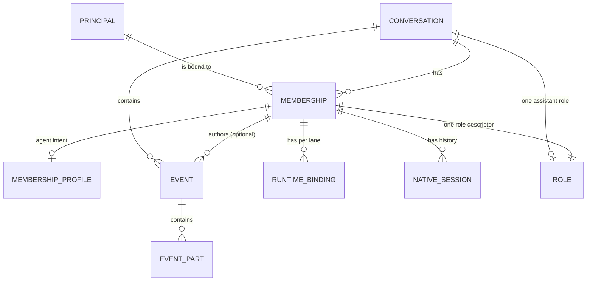

# Conversation Schema Freeze

## 会话模式冻结设计

**Status:** proposed freeze for review. This document does not change runtime behavior and does not
claim that a migration has been applied.

**Summary (中文):** 本文冻结 Conversation、Membership、Event、Role、RuntimeBinding 五个实体的
稳定身份、字段、不变量、生命周期与版本化规则，并给出相对当前仓库存储形态的精确差异清单。
文中所有当前字段、表名、索引名和常量均来自代码；目标设计部分会明确标注为 proposed。

**Scope:** the canonical Conversation authority owned by `licoup-conversation`, plus the adjacent
stores a migration must consider (`licoup-client-state`, `licoup-workflow-store`, and the native
history/snapshot projections under `crates/licoup/src/domain/conversation`). Wire schemas under
`schemas/` are included in the difference analysis.

**Non-goals:** no UI contract changes, no new Agent adapter behavior, no claim that the proposed
Role relation is already persisted, and no test claim. No test suite was run for this document.

**Citation convention.** Abbreviated references in this document expand as follows:

| Abbreviation | Full repository path |
|:---|:---|
| `store/...` | `crates/licoup-conversation/src/store/...` |
| `client_conversation/...` | `crates/licoup-conversation/src/client_conversation/...` |
| `continuity/...` | `crates/licoup-conversation/src/continuity/...` |
| `resources/...` | `crates/licoup-conversation/resources/...` |
| `client-state/...` | `crates/licoup-client-state/src/...` |
| `workflow-store/...` | `crates/licoup-workflow-store/src/...` |
| `service.rs` | `crates/licoup/src/domain/client_conversation/service.rs` |
| `native_roles.rs` | `crates/licoup/src/domain/native_roles.rs` |

---

## 1. Authority and version anchors

| Authority | Current anchor | Meaning |
|:---|:---|:---|
| Canonical Conversation SQLite | `schema_meta.version = "19"` (`crates/licoup-conversation/src/store/mod.rs:68`, `store/schema.rs:722-729`) | Physical schema generation for `client-state/conversations/conversations.sqlite3` |
| Continuity extension SQLite | `continuity_schema.version = "7"` (`crates/licoup-conversation/src/continuity/migrate.rs:9-10`) | Additive continuity tables plus `conversations.designation_epoch` |
| Portable Conversation bundle | `lico.conversation.v1` (`crates/licoup-conversation/src/client_conversation/mod.rs:13`) | Export/import JSON bundle, not the SQLite generation |
| Client bridge document | `ConversationBridge`, `version: 1` (`schemas/client_bridge/conversation.json:2-3`) | Action vocabulary and enums; it does not define the five storage entities |
| Client-state collection document | `v0.0.1:schema:definition-1` (`crates/licoup-client-state/src/policy.rs:8`) | JSON collection files under the portable state root |
| Adaptive Flywheel SQLite | `strategy_meta.version = "3"` (`crates/licoup-workflow-store/src/store.rs:1448-1451`) | Workflow strategy database |
| Workflow queue marker | `workflow_store_meta.version = 1` (`crates/licoup-workflow-store/src/queue.rs:388-392`) | Durable queue table generation |
| Native history catalog | `CONVERSATION_SCHEMA_VERSION: u32 = 2` (`crates/licoup/src/domain/conversation/history/mod.rs:28`) | Read-only native history projection, unrelated to canonical Conversation |
| Native snapshot collection | `v0.0.1:agent:native-conversation-snapshot-1` (`crates/licoup/src/domain/conversation/snapshot_collection.rs:5`) | Archive snapshot documents, not canonical Conversation |

There are therefore several independent version axes that a migration plan must not conflate.
The two SQLite generations are `19` (canonical) and `7` (continuity extension); the portable
bundle is `lico.conversation.v1`; the workflow database is `3`; client-state collections are
`v0.0.1:schema:definition-1`. Native history (`u32 = 2`) and snapshot collections
(`v0.0.1:agent:native-conversation-snapshot-1`) add two more read-model markers.

### 1.1 Sole owners

| Data | Sole owner | Storage |
|:---|:---|:---|
| Conversation, Membership, Event, canonical runtime binding | `licoup-conversation` | SQLite `conversations.sqlite3` |
| Continuity goals/agreements/matters and designation epoch | `licoup-conversation::continuity` | Same SQLite file, separate tables and version marker |
| Client preferences, targets, archive profiles, activity, snapshots | `licoup-client-state` | JSON collection files, JSONL activity, JSON snapshots |
| Adaptive Flywheel definitions, runs, queue, subscriptions | `licoup-workflow-store` | SQLite `strategies.sqlite3` |
| Native Agent history | `crates/licoup/src/domain/conversation/history` | Read-only projection over third-party files and SQLite stores |
| Native archive snapshots | `crates/licoup/src/domain/conversation/snapshots` | JSON collection under a configured snapshot root |

No component may write another owner's tables or documents. A migration step belongs to the
store that owns the target schema, and no transaction spans two SQLite files.

---

## 2. Entity model and cardinality



| Relation | Cardinality | Current enforcement |
|:---|:---|:---|
| Conversation → Membership | 1 : 0..N, at least one active owner | Application checks in `leave_member` and `set_member_access` (`store/mod.rs:2233-2360`) |
| Conversation → Assistant Membership | 1 : 0..1 | Single nullable column `conversations.assistant_membership_id` (`store/schema.rs:20`) |
| Membership → Membership profile | 1 : 0..1 (1 : 1 for active Agent memberships) | `membership_profiles.membership_id` primary key (`store/schema.rs:32-43`); defaults created for Agent members (`store/mod.rs:5407-5426`) |
| Conversation → Event | 1 : 0..N | `events.conversation_id` FK with cascade (`store/schema.rs:46-52`) |
| Event → Event Part | 1 : 0..N | `event_parts.event_id` FK with cascade and `UNIQUE(event_id, ordinal)` (`store/schema.rs:54-59`) |
| Membership → RuntimeBinding | 1 : 0..1 per `(conversation_id, lane)` | `UNIQUE(conversation_id, membership_id, lane)` (`store/schema.rs:77-83`) |
| Membership → Native session | 1 : 0..N | `conversation_native_sessions` primary key `(conversation_id, membership_id, native_session_id)` (`store/native_sessions.rs:5-11`) |
| Conversation → Role | 1 : 0..1 assistant role, 1 : N role descriptors | Derived; current authority is the assistant column plus `membership_profiles.responsibility` |

### 2.1 Identity conventions

- Identifiers are opaque `TEXT`, validated by `validate_identifier`: non-empty, at most 160 bytes,
  and no whitespace or control characters (`store/mod.rs:5527-5537`).
- Generated identifiers use `new_id(prefix)` → `prefix:<uuid-v4>` (`store/mod.rs:5554-5556`).
- The reserved local group is the one fixed Conversation identifier: `lico-group-default`
  (`client_conversation/mod.rs:14`).
- Membership, Event, Event Part, Runtime Binding and Dispatch identifiers are all generated with
  their own prefixes; the prefix is not part of the schema contract beyond the reserved group.
- `principals.id` is the stable principal identity (`agent:<agent_id>`, `agent:<host>:<slug>`, or
  `human:local` in current producers). A Membership binds one principal to one Conversation.

---

## 3. Conversation

### 3.1 Frozen fields

Stored in `conversations` (`crates/licoup-conversation/src/store/schema.rs:16-23`):

| Field | SQL type and constraints | API type | Rules |
|:---|:---|:---|:---|
| `id` | `TEXT PRIMARY KEY` | `String` | Immutable. Opaque identifier; reserved value `lico-group-default` |
| `title` | `TEXT NOT NULL` | `String` | Required non-blank at the API (`validate_required_text`); at most 1 MiB and no NUL (`store/mod.rs:5539-5552`); no DB non-blank CHECK |
| `archived` | `INTEGER NOT NULL DEFAULT 0 CHECK(archived IN (0,1))` | `bool` | Visible lifecycle bit; default group cannot remain archived |
| `pinned` | `INTEGER NOT NULL DEFAULT 0 CHECK(pinned IN (0,1))` | `bool` | List ordering only; independent of `archived` |
| `is_group` | `INTEGER NOT NULL DEFAULT 0 CHECK(is_group IN (0,1))` | `bool` | Direct vs group semantics; group creation requires at least one Agent member (`store/mod.rs:1526-1545`) |
| `strategy_revision` | `TEXT` nullable | `Option<String>` | Only a group Conversation may set it; the update is refused when `is_group=0` (`store/mod.rs:1833-1869`) |
| `assistant_membership_id` | `TEXT REFERENCES memberships(id)` nullable | `Option<String>` | One visible Assistant; target must be an active Agent Membership in the same Conversation (`store/mod.rs:1874-1956`) |
| `revision` | `INTEGER NOT NULL DEFAULT 0` | `i64` | Monotonic change counter, not a full history. Compare-and-set for Assistant designation; Profile updates use `membership_profiles.revision` |
| `created_at` | `INTEGER NOT NULL` | `i64` unix ms | Immutable after insert |
| `updated_at` | `INTEGER NOT NULL` | `i64` unix ms | Written from host clock on each mutation; no DB monotonic constraint |
| `designation_epoch` | `INTEGER NOT NULL DEFAULT 0` (continuity extension; not in the base DDL string) | `i64` | Incremented by trigger when `assistant_membership_id` changes (`continuity/migrate.rs:13-20`) |

`Conversation` also exposes two **derived** fields that are not columns:

| Derived field | Source | Note |
|:---|:---|:---|
| `memberships` | `memberships` rows ordered by `joined_at ASC, id ASC` (`store/mod.rs:3613-3622`) | Includes `left` memberships; it is not only the active roster |
| `event_count` | `COUNT(*)` over `events` (`store/mod.rs:4246-4305`) | Recomputed per read |

`ConversationSummary` adds `membership_count`, `event_count`, `member_agent_ids`, and
`has_local_owner` (`client_conversation/mod.rs:76-94`). These are projections, not persisted fields.

### 3.2 Identity and uniqueness

- Primary identity: `conversations.id`.
- Assistant role uniqueness: at most one non-null `assistant_membership_id` per Conversation,
  enforced by the single column rather than by an index.
- Title uniqueness: none. Two Conversations may share a title.
- No natural key based on title, Agent, source path, model, or timestamp. Source adoption uses
  `migration_provenance`/`source_links`, never a title heuristic (`store/native_sessions.rs:104-155`).
- Ordering: `list` and `list_inner` return `pinned DESC, updated_at DESC, id DESC`
  (`store/mod.rs:4221-4245`). This is a read contract; it is not a stored rank.

### 3.3 Invariants

1. **Owner presence.** Every Conversation has at least one active owner Membership
   (`access='owner'`). `leave_member` and `set_member_access` refuse removing the last owner with
   `conversation_requires_owner` (`store/mod.rs:2255-2272`, `2318-2332`). Mutations that specifically
   require the local human owner additionally use `ensure_local_owner` and reject with
   `local_owner_required` (`store/mod.rs:5455-5471`).
2. **Assistant eligibility.** A designated Assistant must be an active Agent Membership of the same
   Conversation. Repeating the current designation/clear is a no-op and returns before the revision
   check; an actual change with a stale `expected_revision` is rejected with
   `conversation_revision_stale` (`store/mod.rs:1874-1956`).
3. **Assistant uniqueness.** Only one Assistant can exist. Designating a new one demotes the previous
   Profile responsibility to `member` in the same transaction (`store/mod.rs:1918-1945`).
4. **Group minimum.** `create_conversation_with_members` rejects a group with no Agent member with
   `invalid_request` (`store/mod.rs:1537-1544`). A direct Conversation may have zero Agent members.
5. **Group normalization.** Startup normalization sets `is_group=1` when a Conversation is the
   reserved group, is pinned, has a `group` migration provenance, or has more than two active
   Memberships (`store/schema.rs:705-720`). This is a one-way normalization; code does not downgrade
   `is_group`.
6. **Revision monotonicity.** `revision` only increments. There is no update path that assigns a
   lower value. Event appends, Membership changes, rename, pin, archive, strategy, and Assistant
   changes all advance it (`bump_revision`, `store/mod.rs:5390-5404`).
7. **Reserved group.** `lico-group-default` is the reserved Conversation: its creation path sets
   `pinned=1` and `is_group=1`, reset forces `pinned=1`, and it can never remain archived. An archive
   request resets it in place instead of creating a duplicate (`store/mod.rs:1691-1745`,
   `5100-5135`).
8. **Archive cascade.** Archiving a Conversation also archives continuity children and marks the
   native sessions used by the archived subtree (`store/mod.rs:1691-1745`, `4985-5025`). The Agent's
   own files are never deleted.
9. **Clear semantics.** `conversation.clear` is group-only, refuses in-flight work, archives
   continuity children, deletes visible Event history, and rotates the Assistant Membership
   (`store/mod.rs:1753-1790`, `5058-5098`).

### 3.4 Lifecycle

```
created (archived=0, revision=0)
  ├─ rename / pin / strategy / membership / event  → revision+1, updated_at
  ├─ archive (archived=1)
  │    ├─ unarchive (archived=0)                    → native archive marks removed
  │    └─ archive + reopen (groups)                 → archived predecessor + silent successor
  │         successor: same title/strategy, active memberships copied, no join/leave events,
  │         one conversation-reset notice
  ├─ clear (groups only)                            → Event history deleted, successor children archived,
  │                                                   Assistant rotates, same Conversation stays active
  └─ reserved group archive                         → reset in place: events cleared, Assistant rotates,
                                                      conversation-reset notice, still pinned/grouped
```

- Unarchive is the inverse for browse visibility: it deletes this Conversation's rows from
  `archived_native_sessions` (`store/mod.rs:5027-5035`).
- A reopened group creates a new `conversations.id`, new `memberships.id` values, and no runtime
  bindings (`store/mod.rs:5137-5217`). Native history is deliberately not copied as bindings.
- Conversation rows are not physically deleted by ordinary product operations. The reserved-group
  adoption path can move dependent rows onto `lico-group-default` and then delete the legacy row
  (`store/mod.rs:3860-3910`); migrations can also remove retired rows. Export/import refuses identity
  collisions and never overwrites an existing identity (`store/mod.rs:3509-3575`).

### 3.5 Persistence and versioning

- One row per Conversation in `conversations`; no effective-dated Conversation row set.
- The current SQLite generation is `19`. A normal open of an older store fails before mutation with
  `conversation_schema_migration_required`; only `open_for_migration` upgrades
  (`store/schema.rs:180-199`, `store/mod.rs:524-559`).
- The portable bundle stores a point-in-time `Conversation` value plus all Events, with
  `schemaVersion: "lico.conversation.v1"` (`store/mod.rs:3454-3507`). It intentionally omits runtime
  handles, absolute paths, and migration internals.
- **Current export/import gap (verified):** `export_bundle` serializes `Conversation`, so the JSON
  **does** include `assistantMembershipId` when set, but it does not include `membership_profiles` or
  `designationEpoch`. `import_bundle` then inserts `conversations` without
  `assistant_membership_id`/`designation_epoch` and inserts no `membership_profiles`
  (`store/mod.rs:4856-4887`). The exported Assistant pointer is therefore discarded on import, and
  Profile intent/epoch are not portable at all. A freeze must either version the bundle to carry and
  apply these fields or explicitly declare them non-portable.

---

## 4. Membership

### 4.1 Frozen fields

`memberships` (`store/schema.rs:25-31`):

| Field | SQL type and constraints | API type | Rules |
|:---|:---|:---|:---|
| `id` | `TEXT PRIMARY KEY` | `String` | Stable across leave/rejoin; a rejoin reuses the existing left row (`store/mod.rs:2178-2210`) |
| `conversation_id` | `TEXT NOT NULL REFERENCES conversations(id) ON DELETE CASCADE` | `String` | Scope and routing key |
| `principal_id` | `TEXT NOT NULL REFERENCES principals(id)` | `String` | Principal identity; no per-Conversation principal copy |
| `access` | `TEXT NOT NULL CHECK(access IN ('owner','member'))` | `MembershipAccess` | Authorization role; independent of functional responsibility |
| `status` | `TEXT NOT NULL CHECK(status IN ('active','left'))` | `MembershipStatus` | Lifecycle; no terminal deletion state |
| `joined_at` | `INTEGER NOT NULL` | `i64` unix ms | Set at first join; **not** reset on reactivation |
| `left_at` | `INTEGER` nullable | `Option<i64>` | Set on leave, cleared on reactivate |

`principals` (supporting identity table, `store/schema.rs:12-15`):

| Field | SQL type | Rules |
|:---|:---|:---|
| `id` | `TEXT PRIMARY KEY` | `validate_identifier` |
| `kind` | `TEXT NOT NULL CHECK(kind IN ('human','agent'))` | Determines whether a Profile row is created |
| `display_name` | `TEXT NOT NULL` | Non-blank at API |
| `agent_id` | `TEXT` nullable | Adapter identity for Agent principals; native role and target matching |
| `created_at` | `INTEGER NOT NULL` | Insert time |

`membership_profiles` (Agent-only intent, `store/schema.rs:32-45`; v9 added reasoning effort):

| Field | SQL type and constraints | API type | Rules |
|:---|:---|:---|:---|
| `membership_id` | `TEXT PRIMARY KEY REFERENCES memberships(id) ON DELETE CASCADE` | `String` | One profile per Membership |
| `revision` | `INTEGER NOT NULL` | `i64` | Monotonic; stale expected revision rejected with `profile_revision_stale` (`store/mod.rs:2039`) |
| `responsibility` | `TEXT NOT NULL DEFAULT 'member' CHECK(responsibility IN ('assistant','member'))` | `ProfileResponsibility` | Functional Role, set only by Assistant designation / demotion |
| `required_capabilities` | `TEXT NOT NULL DEFAULT '[]'` | JSON array | Max 32 entries, each 1..128 bytes (`client_conversation/mod.rs:196-224`) |
| `preferred_capabilities` | `TEXT NOT NULL DEFAULT '[]'` | JSON array | Same bound |
| `skill_references` | `TEXT NOT NULL DEFAULT '[]'` | JSON array | Input max 32 entries; sorted/deduplicated; Assistant normalization appends `licoup-guide`, so a stored array can contain 33 (`store/mod.rs:5473-5488`) |
| `preferred_model` | `TEXT` nullable | `Option<String>` | 1..128 bytes if present |
| `preferred_reasoning_effort` | `TEXT` nullable | `Option<String>` | 1..128 bytes if present; nullable preserves native default |
| `preferred_environment` | `TEXT` nullable | `Option<String>` | 1..128 bytes if present |
| `preferred_permission_mode` | `TEXT` nullable | `Option<String>` | Added by layout evolution (`store/schema.rs:675-680`) |
| `preferred_instructions` | `TEXT` nullable | `Option<String>` | Max 8192 bytes if present; delivered as generated instruction, never Event text |
| `preferred_context_window` | `INTEGER` nullable | `Option<u64>` | 1..8,000,000 tokens if present |
| `updated_at` | `INTEGER NOT NULL` | `i64` unix ms | Set on create/update |

### 4.2 Identity and uniqueness

- Primary identity: `memberships.id`.
- Natural key: **exactly one Membership row per `(conversation_id, principal_id)`**.
- The final unique index is `memberships_principal_unique` on `(conversation_id, principal_id)`
  (`store/schema.rs:1077-1083`). This is created by dropping the earlier partial index
  `memberships_active_unique` on `(conversation_id, principal_id) WHERE status='active'`.
- Important current fact: the canonical DDL string still declares `memberships_active_unique`
  (`store/schema.rs:30`), but `ensure_converged_membership_index` drops it during every open/upgrade.
  The effective schema therefore has only `memberships_principal_unique`. Keeping both would allow a
  left row and an active row for the same principal, which the application deliberately no longer
  permits.
- v12 convergence retargets all dependent rows onto one surviving Membership id before deleting
  duplicates (`store/schema.rs:1020-1034`, `store/mod.rs:3640-3815`).

### 4.3 Invariants

1. **One row per principal.** Join after leave reactivates the same row and id; it does not insert a
   second row (`store/mod.rs:2178-2210`). This is enforced by the application and by
   `memberships_principal_unique`.
2. **At least one active owner.** Enforced on leave and access demotion (`store/mod.rs:2255-2272`,
   `2318-2332`). Owner promotion is unrestricted; a Conversation may have several owners.
3. **Status and timestamp coherence.** `status='left'` sets `left_at`; reactivation sets
   `status='active'` and `left_at=NULL`. This is an API invariant, not a SQL CHECK.
4. **Profile only for Agent Memberships.** `membership_profiles` rows are created for Agent
   principals on add and by migration/default paths; Human principals have no profile
   (`store/mod.rs:5407-5426`). The current import path does **not** insert profiles (see §3.5).
5. **Profile revision.** `revision` increments on every profile change. Equal revision is idempotent;
   older expected revision is rejected. Profile fields have no partial-null semantics: absent JSON
   arrays are `[]`, absent optionals are `NULL`.
6. **Assistant responsibility.** `responsibility='assistant'` is set only through
   `set_conversation_assistant`; leaving the Assistant role demotes to `member` and clears the
   Conversation pointer (`store/mod.rs:2266-2296`).
7. **Immutable columns.** `id`, `conversation_id`, `principal_id`, and `joined_at` do not change for
   the lifetime of a Membership row. `access`, `status`, and `left_at` are lifecycle fields.
   A rejoin reactivates the row but does not rewrite `joined_at` (`store/mod.rs:2180-2208`).
8. **Membership churn is evented.** Join appends a `membership-changed` Event with a `Metadata` Part
   containing `membershipId`, `principalId`, and `change:"joined"`; leave contains
   `membershipId` and `change:"left"`; access-set contains `membershipId`, `change:"access-set"`, and
   the new `access` (`store/mod.rs:2214-2226`, `2283-2298`, `2340-2357`). These are durable facts,
   not audit logs in a separate table.
9. **Hard deletion is limited to rotation and convergence.** Product paths normally leave rows in
   `status='left'`. The exception is Assistant rotation on `conversation.clear` and reserved-group
   reset: `rotate_assistant_membership` deletes the old Assistant Membership, creates a new
   Membership id for the same principal, and copies the Profile (`store/mod.rs:5219-5305`). v12
   convergence and migration are the other deletion paths. Runtime bindings and native sessions of
   the deleted Assistant row are removed by FK cascade. Reserved-group reset writes native archive
   marks first; `conversation.clear` does not write archive marks before rotating.

### 4.4 Lifecycle

```
(no row) --add--> active
active --leave--> left --add/reactivate--> active
active --access owner<->member--> active
active --assistant designation--> responsibility assistant
active --demotion/leave--> responsibility member
```

`MembershipStatus` is generated from `resources/state-machines.json`: `active` and `left`, with
`leave` and `reactivate` transitions, initial `active`, no terminal state
(`resources/state-machines.json:359-386`). The generated table is the transition authority; the
store owns the transaction and owner guard (`store/lifecycle.rs:26-45`).

### 4.5 Persistence and versioning

- Membership and Profile rows are current-state only. There is no effective-dated Membership history.
  Change history is the Event stream plus Profile `revision`.
- `joined_at` is the original join time; rejoin does not rewrite it. Consumers that need the current
  active period must use `left_at` plus the membership-changed Events.
- No separate Membership schema version. Its layout follows the canonical Conversation generation
  (`19`) and is validated by the complete owner contract (`store/schema.rs:385-446`).

---

## 5. Event

### 5.1 Frozen fields

`events` (`store/schema.rs:46-53`):

| Field | SQL type and constraints | API type | Rules |
|:---|:---|:---|:---|
| `id` | `TEXT PRIMARY KEY` | `String` | Immutable identity |
| `conversation_id` | `TEXT NOT NULL REFERENCES conversations(id) ON DELETE CASCADE` | `String` | Owning Conversation; cross-Conversation reads are rejected (`store/mod.rs:2609-2634`) |
| `sequence` | `INTEGER NOT NULL` | `i64` | Current order key; `UNIQUE(conversation_id, sequence)` |
| `author_membership_id` | `TEXT REFERENCES memberships(id)` nullable | `Option<String>` | Null for system/domain Events; otherwise must belong to the Conversation |
| `kind` | `TEXT NOT NULL` | `EventKind` | No SQL CHECK; Rust enum is authority. Current variants: `message`, `membership-changed`, `availability`, `conversation-reset` (`client_conversation/mod.rs:312-320`) |
| `causation_id` | `TEXT` nullable | `Option<String>` | Optional Event id; no FK. Used for derived subtree deletion and continuity anchors |
| `correlation_id` | `TEXT` nullable | `Option<String>` | Optional correlation, commonly a Dispatch id |
| `created_at` | `INTEGER NOT NULL` | `i64` unix ms | Insert time |
| `finalized` | `INTEGER NOT NULL DEFAULT 0 CHECK(finalized IN (0,1))` | `bool` | `0` allows Part appends; `1` is immutable content |

`event_parts` (`store/schema.rs:54-60`):

| Field | SQL type and constraints | API type | Rules |
|:---|:---|:---|:---|
| `id` | `TEXT PRIMARY KEY` | `String` | Immutable |
| `event_id` | `TEXT NOT NULL REFERENCES events(id) ON DELETE CASCADE` | `String` | Owning Event |
| `ordinal` | `INTEGER NOT NULL` | `i64` | `UNIQUE(event_id, ordinal)`; append assigns `MAX+1` |
| `kind` | `TEXT NOT NULL` | `EventPartKind` | No SQL CHECK. Current variants: `text`, `reasoning`, `tool-call`, `tool-result`, `artifact`, `diagnostic`, `metadata`, `image` (`client_conversation/mod.rs:322-333`) |
| `content` | `TEXT NOT NULL` | `String` | Max 1 MiB, no NUL (`validate_text`); image content is `ImageAttachment` JSON (`client_conversation/mod.rs:335-359`) |
| `runtime_cursor` | `INTEGER` nullable | not in public `EventPart` | Private runtime replay cursor (`store/schema.rs:54-60`) |
| `execution_kind` | `TEXT` nullable | not in public `EventPart` | Private runtime replay classification (`store/schema.rs:656`) |
| `created_at` | `INTEGER NOT NULL` | `i64` unix ms | Insert time |

`EventPart` in the public struct has only `id`, `event_id`, `ordinal`, `kind`, `content`, and
`created_at_unix_ms` (`client_conversation/mod.rs:377-386`). `runtime_cursor` and `execution_kind` are
deliberately absent from the portable/public shape.

### 5.2 Idempotent admission

`event_admission_keys` (`store/admission_keys.rs:17-24`):

| Field | SQL type and key | Rules |
|:---|:---|:---|
| `conversation_id` | `TEXT NOT NULL REFERENCES conversations(id) ON DELETE CASCADE` | Scope |
| `admission_key` | `TEXT NOT NULL` | Caller-owned identity of one inbound unit |
| `event_id` | `TEXT` nullable | Set after the Event is inserted; no FK |
| `sequence` | `INTEGER` nullable | Set with `event_id` |
| `created_at` | `INTEGER NOT NULL` | Insert time |
| — | `PRIMARY KEY(conversation_id, admission_key)` | At-most-once append |

The key is inserted before the Event in the same transaction, then updated with the Event identity.
A duplicate key returns `EventAppendOutcome::AlreadyAdmitted` with `event_id`/`sequence` when known
(`store/admission_keys.rs:70-160`). **Current gap:** there is no FK from `event_id` to `events`, and
`delete_posted_message` does not delete admission rows. A deleted Event can therefore leave an
admission record that names a no-longer-present Event.

### 5.3 Identity, ordering, and uniqueness

- Primary identity: `events.id`.
- Ordering key: `(conversation_id, sequence)`, unique and indexed
  (`events_conversation_idx` on `(conversation_id, sequence)`).
- `sequence` is assigned with `SELECT COALESCE(MAX(sequence), 0)+1` inside the writer transaction
  (`store/mod.rs:4488-4492`). It is **not** a global timestamp and **not** an immutable revision:
  - deleting a middle Event leaves a gap;
  - deleting the current maximum allows the next insert to reuse that number;
  - reserved-group normalization resequences surviving Events contiguously in original order
    (`store/schema.rs:4140-4170`).
- `event_parts.ordinal` is per-Event and unique; appends use `MAX(ordinal)+1`.
- No uniqueness on `causation_id` or `correlation_id`. A Dispatch may correlate with more than one
  Event; readers must use the documented query (`agent_turn_event_for_dispatch`, `store/mod.rs:3327-3352`).
- Page ordering: `afterSequence` reads ascending; `latest` and `beforeSequence` read descending then
  reverse the selected page. `nextCursor` is the last returned sequence; `beforeSequence` is the
  first returned sequence only when earlier rows exist (`store/mod.rs:4320-4375`). The desktop page
  reads 20 by default, max 100 (`client_conversation/mod.rs:400-406`; `store/mod.rs:58-59`).

### 5.4 Invariants

1. **Author belongs to the Conversation.** `insert_event` validates the author Membership and status
   (`store/mod.rs:4469-4487`). Public appends require `active`; internal/system appends may use a
   `left` author or `NULL`.
2. **Finalized content is immutable.** `append_event_part` refuses when `finalized=1` with
   `event_already_finalized` (`store/mod.rs:2772-2804`). `finalize_event` is idempotent only in the
   sense that a second call is refused; it never reopens an Event (`store/mod.rs:3051-3071`).
3. **Part ordinals are dense per Event at creation.** `insert_event` uses `0..n-1`; later appends use
   `MAX+1`. Deletion is whole-Event only, so holes cannot be introduced through the public API.
4. **Event content is append-only before finalization.** There is no update of `content`, `kind`,
   `ordinal`, or `author_membership_id` in product paths. The only content mutation is
   cold-recovery adding a `diagnostic` Part to an unfinalized message Event before finalizing it
   (`store/recovery.rs:113-160`).
5. **Whole-Event deletion is restricted.** `delete_posted_message` requires the caller to be the
   active human owner who authored a `message` Event; it refuses while any derived turn is active;
   it deletes the causation subtree and its search rows (`store/mod.rs:2685-2770`). There is no
   generic Event delete API.
6. **Search is derived.** `event_search` is an FTS5 table over `text`/`reasoning` Parts
   (`store/schema.rs:71`). It is rebuilt when corrupt or empty while source Parts exist
   (`store/schema.rs:733-776`). It is never the authority for Event content or ordering.
7. **System Events.** Domain Events (`membership-changed`, `conversation-reset`) are inserted with
   no author, `finalized=1`, and exactly one `Metadata` Part (`store/mod.rs:6013-6049`).
8. **Bounded append.** One Event append accepts at most 4096 Parts and validates each Part content;
   the `event_parts` table has no count CHECK, so this is an API invariant
   (`store/mod.rs:2420-2422`; `store/admission_keys.rs:93-95`).

### 5.5 Lifecycle

```
append_event(finalized=false) → append_event_part* → finalize_event → immutable
append_event(finalized=true)  → immutable immediately
append_event(finalized=false) + host crash → cold_recover adds diagnostic + finalizes
```

- Event kinds are lifecycle-typed: `message` for content; `membership-changed` for roster facts;
  `conversation-reset` for archive/successor notices; `availability` is declared but this crate has
  no producer for it (verified by grep; the variant exists at `client_conversation/mod.rs:315`).
- A `conversation-reset` Event is the only Event that opens a successor/reset; it is not a member
  join/leave record.
- Cold recovery finalizes all `message` Events left at `finalized=0`, not only those correlated to a
  recovered Dispatch (`store/recovery.rs:86-108`).

### 5.6 Persistence and versioning

- Events and Parts are in the same SQLite file and version generation as Conversation and Membership.
- Export/import preserves Event ids, sequences, Parts, content, and finalization exactly; it validates
  identity, strict sequence growth, Part ordinal/content, and author membership before insert
  (`store/mod.rs:4767-4818`).
- `event_search` is not exported and is rebuilt from Parts on open (`store/schema.rs:733-776`).
- Runtime cursor metadata is private and is not part of `EventPart` or the portable bundle.

---

## 6. Role

### 6.1 Freeze decision

**Role is frozen as a read-only contract over existing authority, not as a new writable table.**
The current schema has no role table. Schema generation `1` explicitly dropped
`conversation_roles` and `role_candidates` (`store/schema.rs:498-499`), so those names are historical
and must not be treated as current. Reusing the name `conversation_roles` requires the decision in
§10.

A Role is the pair of **(authorization role, functional responsibility)** attached to one Membership.
It is derived from three authoritative sources:

| Role field | Type | Current source | Rules |
|:---|:---|:---|:---|
| `conversation_id` | `TEXT` | `memberships.conversation_id` | Scope |
| `membership_id` | `TEXT` | `memberships.id` | Identity of the role holder |
| `principal_kind` | `human \| agent` | `principals.kind` | Humans have no functional profile |
| `authorization_role` | `owner \| member` | `memberships.access` | Independent of functional role |
| `functional_role` | `assistant \| member` or null | `membership_profiles.responsibility` | Null for Human Memberships |
| `is_assistant` | `bool` | `conversations.assistant_membership_id = memberships.id` | At most one true per Conversation |
| `designation_epoch` | `i64` | `conversations.designation_epoch` | Increments on Assistant pointer change |
| `profile_revision` | `i64` | `membership_profiles.revision` or `0` | Version of functional intent |
| `skill_references` | JSON array | `membership_profiles.skill_references` | Sorted/deduplicated; Assistant includes `licoup-guide` |
| `native_role_ref` | `string` or null | first `skill_references` entry starting with `native-role:` | Optional external role definition |
| `native_role_name` | `string` or null | discovered role file | Not persisted in SQLite |
| `native_role_instructions` | `string` or null | discovered role file | Not persisted in SQLite; delivered as generated guidance |
| `membership_status` | `active \| left` | `memberships.status` | Left descriptors remain readable but not dispatchable |
| `updated_at` | `i64` | max(profile `updated_at`, conversation `updated_at`) | Projection timestamp |

### 6.2 Identity and cardinality

- Identity: `(conversation_id, membership_id)`. A Role descriptor cannot exist without a Membership.
- Continuity's `responsibleRoleRef` is a **different** free-string vocabulary stored inside
  `continuity_goals.contract`, not a foreign key to this descriptor. Current producers use
  `role:assistant` (`continuity/generated.rs:564`, `continuity/commit.rs:446-450`). The freeze does
  not equate the two.
- One descriptor per Membership; zero or one Assistant descriptor per Conversation.
- Authorization role and functional role are orthogonal:
  - a human owner has `authorization_role=owner`, `functional_role=null`;
  - an Agent member has `authorization_role=member`, `functional_role=member`;
  - the designated Agent Assistant has `functional_role=assistant` and may be owner or member;
  - a native role is an Agent Member with a `native-role:` skill reference.

### 6.3 Invariants

1. **Exactly one descriptor per Membership.** The projection cannot invent a Role for a missing
   Membership, and it cannot hide a Membership role.
2. **At most one Assistant.** Enforced by `conversations.assistant_membership_id`; assigning a new
   Assistant demotes the old Profile responsibility in the same transaction
   (`store/mod.rs:1918-1945`).
3. **Assistant skill normalization.** An Assistant Profile always contains `licoup-guide`; all
   `skill_references` are sorted and deduplicated (`store/mod.rs:5473-5488`).
4. **Native role resolution is first-match.** `role_from_skill_refs` uses `find_map`, so multiple
   `native-role:` references are representable but only the first in stored `skill_references` order
   is effective (`crates/licoup/src/domain/native_roles.rs:73-77`). Normal profile writes sort the
   array, so the effective order is lexicographic after normalization. A freeze should either
   restrict to one effective reference or define precedence.
5. **Designation epoch.** Changing `assistant_membership_id` increments `designation_epoch` through
   the SQLite trigger; clearing and re-designating the same Membership also advances it
   (`continuity/migrate.rs:13-20`). Continuity writes compare this epoch and reject stale proposals
   (`continuity/admission.rs:114`).
6. **No role row, no role history.** Role changes are represented by the current Membership/Profile
   state plus `membership-changed` Events and `designation_epoch`. There is no separate Role revision
   history.
7. **Role is not portable in effect.** The `lico.conversation.v1` export serializes
   `assistantMembershipId`, but it does not contain `membership_profiles` or `designation_epoch`,
   and import discards the Assistant pointer (see §3.5). Imported Conversations therefore lose
   functional Role state. The current portable contract is **authorization-role-only**.
8. **Native role definitions are external.** They are discovered from host Agent configuration,
   never written by LicoUp (`crates/licoup/src/domain/native_roles.rs:128-260`). Removing a role file
   makes `find` return `None`; the next dispatch silently omits its instructions rather than failing
   the turn (`crates/licoup/src/domain/client_conversation/service.rs:1713-1755`).
9. **No independent ordering.** A Role is read per Membership. If the proposed view is added, its
   deterministic order should be `joined_at ASC, membership_id ASC`. `conversation_id`,
   `membership_id`, and `principal_kind` are immutable for the life of that Membership; only the
   authorization/functional fields change through the transitions above.

### 6.4 Lifecycle

```
Membership created (agent)  → Profile default responsibility=member
Assistant designation       → old assistant responsibility=member
                              new assistant responsibility=assistant, skill licoup-guide added
                              assistant_membership_id updated, designation_epoch+1
Assistant leave/demotion    → responsibility=member, pointer cleared (leave path)
Membership leave            → status=left; descriptor readable, not dispatchable
Membership reactivate       → status=active; descriptor usable again; same id
Conversation reset          → Assistant Membership rotates to a new Membership id; profile intent copied
                              to the new row; old row, its binding and its native-session associations
                              are deleted. Reserved-group reset writes native archive marks first;
                              `conversation.clear` does not.
```

The last transition is a true identity change, not a relabel: any Role key that contains the old
`membership_id` is invalid after a reset.

### 6.5 Persistence and versioning

- No independent Role table or view exists today. The contract is a projection.
- Version tuple: `(conversation.revision, profile.revision, conversation.designation_epoch)`.
  Consumers that cache a Role must include all three; a matching profile revision with a changed
  designation epoch is stale.
- If an addressable SQL relation is required, the safe implementation is a **read-only view**
  (working name `conversation_roles`), created by a future migration from the same sources, not a
  second writable authority. The view can be dropped and recreated reversibly because it stores no
  rows.

---

## 7. RuntimeBinding

### 7.1 Frozen fields

`runtime_bindings` (`store/schema.rs:77-83`):

| Field | SQL type and constraints | API exposure | Rules |
|:---|:---|:---|:---|
| `id` | `TEXT PRIMARY KEY` | `RuntimeBinding.id` | Surrogate identity; **not** the natural key |
| `conversation_id` | `TEXT NOT NULL REFERENCES conversations(id) ON DELETE CASCADE` | public + private | Scope |
| `membership_id` | `TEXT NOT NULL REFERENCES memberships(id) ON DELETE CASCADE` | public + private | Binding is Membership-scoped, not Conversation-scoped |
| `lane` | `TEXT NOT NULL` | public | Current producer uses only `conversation`; no SQL CHECK |
| `availability` | `TEXT NOT NULL` | public | Current producer uses only `available`; no SQL CHECK |
| `safe_reason` | `TEXT` nullable | public | Privacy-safe reason when unavailable; not a raw error |
| `runtime_session_id` | `TEXT` nullable | **private only** | Native Agent session identity |
| `runtime_conversation_path` | `TEXT` nullable | **private only** | Adapter conversation file/path |
| `working_directory` | `TEXT` nullable | **private only** | Execution working directory |
| — | `UNIQUE(conversation_id, membership_id, lane)` | — | Natural key; upsert target |

Public `RuntimeBinding` intentionally contains only `id`, `conversation_id`, `membership_id`, `lane`,
`availability`, and `safe_reason` (`client_conversation/mod.rs:419-427`). `PrivateRuntimeBinding`
contains `conversation_id`, `membership_id`, `runtime_session_id`, `runtime_conversation_path`, and
`working_directory`, has no serialization implementation, and is absent from public projection
(`client_conversation/mod.rs:429-438`).

There is **no `created_at`, `updated_at`, or `revision` column**. A binding is a current pointer, not
a history; native session history is the separate `conversation_native_sessions` table.

### 7.2 Native session history

`conversation_native_sessions` (`store/native_sessions.rs:5-11`):

| Field | SQL type and key | Rules |
|:---|:---|:---|
| `conversation_id` | `TEXT NOT NULL REFERENCES conversations(id) ON DELETE CASCADE` | Owning Conversation |
| `membership_id` | `TEXT NOT NULL REFERENCES memberships(id) ON DELETE CASCADE` | Owning Membership |
| `native_session_id` | `TEXT NOT NULL` | Agent-native session identity |
| — | `PRIMARY KEY(conversation_id, membership_id, native_session_id)` | Insert-only through the binding API; duplicate ignored; FK cascade removes rows with the Membership/Conversation |

`archived_native_sessions` (`store/schema.rs:156-160`):

| Field | SQL type and key | Rules |
|:---|:---|:---|
| `agent_id` | `TEXT NOT NULL` | Agent identity |
| `native_session_id` | `TEXT NOT NULL` | Native session |
| `conversation_id` | `TEXT NOT NULL` | Conversation that archived it; no FK |
| `archived_at` | `INTEGER NOT NULL` | Archive time |
| — | `PRIMARY KEY(agent_id, native_session_id)` | One global archive mark per Agent session |

`conversation_dispatches` is the durable attempt record adjacent to a binding; its
`session_mode` is constrained to `new`/`resume` and its state is constrained
(`store/schema.rs:84-96`). It is not one of the five entities but is required for rebinding.

### 7.3 Identity and invariants

1. **Natural key.** One current binding per `(conversation_id, membership_id, lane)`. The `id` is a
   surrogate, never the routing key. Current upsert preserves it, but callers must not depend on
   that; a deleted/recreated row gets a new `id`. There is no list ordering contract; reads are by
   exact natural key (`private_runtime_binding`) or by the conversation/membership scope.
2. **Membership scope.** A binding cannot outlive its Membership; FK cascade removes it. A
   Conversation cascade removes all bindings.
3. **Private read gate.** `private_runtime_binding` returns `None` unless:
   - the Membership is `active` and belongs to the Conversation;
   - `lane='conversation'`;
   - `availability='available'`;
   - `runtime_session_id IS NOT NULL`.
   (`store/mod.rs:1460-1495`)
4. **Current pointer, historical set.** `bind_runtime_session` upserts the binding but inserts into
   `conversation_native_sessions` with `ON CONFLICT DO NOTHING`; replacing the current session never
   erases earlier associations (`store/mod.rs:1406-1458`, `native_sessions.rs:70-102`).
5. **Path preservation.** Rebinding uses `COALESCE(excluded.path, existing.path)` so an omitted path
   does not erase a previously known path (`store/mod.rs:1433-1445`). `runtime_binding` without
   private location updates only `availability`/`safe_reason` and leaves private columns untouched
   (`store/mod.rs:3100-3115`).
6. **Source link.** `bind_runtime_session` also writes
   `source_links(source_kind='agent-runtime', native_identity)` and
   `migration_provenance(source_kind='projection', ...)` with a length-prefixed identity
   (`agent_id.len():agent_id:session_id`) (`store/mod.rs:1406-1458`, `5558-5570`). This is provenance,
   not a second binding. `runtime_binding_with_private_location` writes the binding and native
   session but not these source rows.
7. **No SQL enum checks.** `lane` and `availability` are `TEXT` with no CHECK. Current writers use
   `conversation` and `available`; a freeze should close these sets (see §10).

### 7.4 Lifecycle and rebinding after restart/reconnect

```
dispatch accepted
  → runtime frame(s) or terminal event
  → bind_runtime_session: upsert runtime_bindings + insert conversation_native_sessions
  → source_links/migration_provenance

host crash / restart
  → ConversationStore::open → cold_recover
  → accepted/running/cancel-requested dispatches become failed(host_lifecycle_interrupted)
  → claimed/running direct turns become interrupted
  → unfinalized message Events get diagnostic + finalized
  → runtime_bindings and conversation_native_sessions remain

next dispatch
  → resolve_dispatch_params reads private_runtime_binding (active membership only)
  → injects sessionId + private paths when caller omitted them
  → prepare_runtime_dispatch records session_mode=resume (session supplied) or new
  → adapter verifies exact native identity; a mismatch is a failed dispatch, not a silent rebind
  → on confirmed frames, bind_runtime_session upserts the same natural key
```

**Restart recovery is store-owned and idempotent.** `cold_recover` runs on every `open` and
`open_for_migration`; once all rows are terminal, later opens report an empty recovery
(`store/recovery.rs:25-110`, `store/mod.rs:524-559`). It writes the privacy-safe error code
`host_lifecycle_interrupted`; it does not delete bindings or native session history.

**Rebinding rules:**

1. Rebind the same natural key `(conversation_id, membership_id, lane)`; do not create a second row
   for a new native session. The old session remains in `conversation_native_sessions`.
2. A binding is usable only while the Membership is active. A Membership that left keeps its row and
   binding, so reactivating the same Membership id makes the binding visible again; this is current
   behavior and must be intentional in the freeze.
3. A successor Conversation created by archive+reopen has new Membership ids and therefore no
   bindings. Its first dispatch starts a new native session; history is not transplanted. A
   reserved-group reset also rotates the Assistant Membership, so the old Assistant binding and
   native-session associations are removed by FK cascade after archive marks are written.
   `conversation.clear` also rotates the Assistant Membership, but does not write native archive
   marks before that cascade.
4. Archive marks native sessions in `archived_native_sessions` and does not delete bindings. Unarchive
   deletes only the marks for that Conversation, restoring browse visibility.
5. A failed resume never silently falls back to an arbitrary session at the store layer. The caller
   may start a new dispatch with `session_mode=new`; that is a new attempt with its own dispatch id.
6. An Assistant designation change advances `designation_epoch`; old bindings remain attached to the
   old Membership. In-flight work keeps its original Membership and epoch for reconciliation.

### 7.5 Persistence and versioning

- Binding rows are current-state only. Native session associations are insert-only through the binding API; FK cascade removes them with the Membership or Conversation.
- No independent version marker. Layout follows canonical generation `19`; the columns
  `runtime_session_id`, `runtime_conversation_path`, and `working_directory` were added by layout
  evolution and are validated as part of the owner contract (`store/schema.rs:652-703`,
  `385-446`).
- Bindings are deliberately excluded from `export_bundle`: no runtime handles, absolute paths,
  executor claims, or migration internals (`store/mod.rs:3450-3457`).
- Rebinding is not a schema migration and must not bump `schema_meta.version`.

---

## 8. Migration principles

### 8.1 Classify before writing

A migration must first be read-only:

1. Read the owning store's version marker (`schema_meta`, `continuity_schema`, `strategy_meta`,
   collection `schemaVersion`).
2. Validate the complete current owner layout through the actual owner DDL, not a hand-kept column
   subset. Conversation uses `validate_migration_source` and `validate_owner_contract`
   (`store/schema.rs:283-446`); workflow uses `validate_published_core_layout`
   (`workflow-store/src/store.rs:1624-1705`).
3. Refuse unknown, newer, malformed, or development-only shapes before any mutation. Conversation
   refuses `13`–`17` and anything outside the supported set (`store/schema.rs:247-267`).
4. Only then acquire the writer/startup admission boundary and run the step.

### 8.2 One step, one owner, one transaction

- Each SQLite step uses `TransactionBehavior::Immediate` and writes its version marker in the same
  transaction as the DDL/backfill (for example `migrate_runtime_replay_v5`,
  `migrate_membership_convergence_v12`, `store/schema.rs:812-837`, `1023-1034`).
- Failure rolls back both data and marker; the source remains at its prior version. A v3 rollback
  test exists at `store/mod.rs:8445-8497`; this document did not run it.
- Cross-store work is not one transaction. Each store commits its own step, then the startup ledger
  records the postcondition. A crash between stores leaves per-store progress, not a torn database.
- The migration owner is the store owner. No second writer, ad hoc SQL script, or UI path may
  produce the target layout.

### 8.3 Compatibility windows

| Store | Normal open | Migration open | Refused |
|:---|:---|:---|:---|
| Canonical Conversation | only `19` | `1`–`12`, `18` → `19` | `13`–`17`, unknown, malformed |
| Continuity extension | `7` (or absent, created) | `<=7`; known pending-state rewrites | `>7`, unparseable |
| Portable bundle | exact `lico.conversation.v1` | none | any other `kind`/`schemaVersion` |
| Client bridge | `version: 1` action vocabulary | none | unsupported action/failure shape |
| Client-state collections | exact `v0.0.1:schema:definition-1` | legacy document with **no** `schemaVersion` gets the current marker | any other marker |
| Workflow SQLite | only `3` | released `2` → `3`; `3` validated | unknown; normal open of `2` is refused |
| Workflow queue | marker `1` | created on demand | malformed existing table |
| Native history catalog | its own `u32 = 2` | not canonical | unrelated to this freeze |

Implications:

- The Conversation compatibility window is currently **very wide** (`1`–`12`, `18`). A freeze should
  preserve at least the last published source generation plus the current one; it must not silently
  drop an already-published upgrade path.
- `13`–`17` are not supported migration inputs. Do not add them as implicit checkpoints.
- A newer store must be refused by an older binary, not "repaired". `validate_current_schema` returns
  `conversation_schema_migration_required` for any version other than `19` before mutation
  (`store/schema.rs:180-199`).
- Wire/API compatibility is separate from storage. `lico.conversation.v1` and bridge `version: 1` do
  not advance just because SQLite advances.

### 8.4 Reversible and irreversible steps

| Step class | Examples in this repository | Reversibility |
|:---|:---|:---|
| Add nullable column | `event_parts.runtime_cursor` (`store/schema.rs:812-837`), `preferred_reasoning_effort` (`store/schema.rs:971-991`) | Reversible: old readers ignore it; no row rewrite required |
| Add table/index | `subagent_dispatch_claims`, `event_admission_keys`, `conversation_native_sessions` | Reversible if readers tolerate absence; otherwise leave in place |
| Add read-only view | proposed `conversation_roles` | Reversible: `DROP VIEW` loses no data |
| Backfill nullable/default data | v7 Profile defaults (`store/schema.rs:870-905`), native-session backfill (`native_sessions.rs:104-155`) | Reversible only if old values are retained or the transform is provably idempotent; otherwise irreversible |
| Table rebuild to change constraints | `membership_profiles` v8 rebuild (`store/schema.rs:912-966`), `strategy_bindings` v1→v2 (`workflow-store/src/store.rs:1710-1742`) | Irreversible in place; requires backup/export |
| Membership convergence | v12 retarget + delete duplicates (`store/schema.rs:1020-1034`) | Irreversible: deleted ids and retargeted FKs cannot be reconstructed from the store alone |
| Drop tables/columns | v1 drops `conversation_roles`, `role_candidates`, `runs`, `flywheels`, and others (`store/schema.rs:476-501`) | Irreversible |
| Delete Events or resequence | `delete_posted_message`, reserved-group normalization (`store/mod.rs:2685-2770`, `4140-4170`) | Irreversible without export/backup |
| Advance version marker | every step | Irreversible for older binaries; they refuse the newer generation |
| Overwrite current runtime binding | `bind_runtime_session` | Recoverable association: old native id remains in `conversation_native_sessions`; old paths may be overwritten |

**Rule:** additive structures may ship before the backfill (expand), but a destructive step must be a
separate, explicitly approved migration after the new reader/writer has been exercised against
synthetic data. There is no automatic downgrade.

### 8.5 Data backfill rules

1. **Never fabricate identity or provenance.** Do not infer ownership from title, model, project
   path, or timestamp. Current native-session backfill uses only explicit evidence:
   `runtime_bindings.runtime_session_id`, `conversation_dispatches.native_provenance`, and the
   length-prefixed `source_links` identity (`native_sessions.rs:104-155`).
2. **Prefer nullable or empty defaults over guessed values.** v9 preserves the native reasoning
   default with `NULL` rather than inventing a value (`store/schema.rs:968-991`). v7 does not assign
   an Assistant to ambiguous groups (`store/schema.rs:865-905`).
3. **Preserve stable ids.** Conversation/Membership/Event/Part ids are never regenerated by a
   backfill. v12 explicitly retargets foreign references before deleting duplicates so surviving
   ids remain valid (`store/mod.rs:3760-3815`).
4. **Preserve authors and content.** Do not rewrite Event authors or text. The one content addition
   is a diagnostic Part during cold recovery; it is an observed host-lifecycle fact, not invented
   content (`store/recovery.rs:113-160`).
5. **Idempotence.** Use `INSERT OR IGNORE`, `ON CONFLICT DO NOTHING`, or an explicit
   current-value check. Re-running a completed step must be a no-op.
6. **Bounded and deterministic.** Backfills read a bounded set, order deterministically, and do not
   call the network, PTY, Agent adapters, or arbitrary external files.
7. **Same transaction as the marker.** A backfill that commits but leaves the old marker is a
   half-step; a marker that advances without the backfill is corruption. Both are written together.
8. **Postcondition before commit.** Validate the exact table/column/key/index/FK contract
   (`validate_owner_contract`) and row-count/foreign-key invariants. The migration is complete only
   after the postcondition, not after DDL success.
9. **No third-party history mutation.** LicoUp may read Agent-native history but never deletes,
   truncates, or rewrites the Agent's own files. Archive marks are LicoUp-owned metadata
   (`store/mod.rs:4985-5035`).

### 8.6 Recommended step shape for a future generation

1. Add the new nullable column/table/view in generation `N+1`.
2. Keep the current reader working against both `N` and `N+1` during the compatibility window.
3. Backfill in one immediate transaction with the version marker; validate postcondition.
4. Switch the writer to the new field; keep a read fallback for old rows.
5. Only after the full window, perform a separate destructive cleanup (drop old column/table,
   tighten CHECK, delete tombstoned rows). That step is irreversible and needs an export.
6. Record the generation in `schema_meta` (canonical), `continuity_schema` (continuity), or
   `strategy_meta` (workflow). Never put a canonical generation into the serialized `Conversation`
   document; the portable bundle uses `lico.conversation.v1`.

---

## 9. Concrete difference list against current storage modes

This section quotes the current repository. It does **not** propose target fields as if they existed.

### 9.1 Canonical Conversation store

| Current fact | Exact source | Difference from the freeze |
|:---|:---|:---|
| SQLite file `client-state/conversations/conversations.sqlite3` | `store/mod.rs:524-527` | Freeze assumes one owner file per data root |
| WAL, `synchronous=FULL`, `fullfsync=ON`, `checkpoint_fullfsync=ON`, `busy_timeout=8000`, `trusted_schema=OFF` | `store/schema.rs:162-177` | Durability settings are part of the storage contract; do not weaken |
| Generation `19` | `store/mod.rs:68` | Docs still say generation `18` (see §9.9) |
| Single DDL string `CONVERSATION_SCHEMA_TABLES` creates `principals`, `conversations`, `memberships`, `membership_profiles`, `events`, `event_parts`, `direct_turns`, `event_search`, `source_links`, `runtime_bindings`, `conversation_dispatches`, `subagent_dispatch_claims`, `subagent_mcp_inbound`, `subagent_dispatch_deliveries`, `migration_provenance`, `archived_native_sessions` | `store/schema.rs:11-160` | The physical schema is a fixed multi-context layout, not five normalized tables |
| Additional tables created outside that string: `schema_meta`, `conversation_native_sessions`, `event_admission_keys` | `store/schema.rs:630-631`, `store/native_sessions.rs:5-11`, `store/admission_keys.rs:17-24` | Entity model must account for three more relations |
| `Conversation` API value contains `memberships` and `event_count` | `client_conversation/mod.rs:57-72` | Not columns; computed per read (`store/mod.rs:4246-4305`, `3613-3622`) |
| `ConversationSummary` contains computed `membership_count`, `event_count`, `member_agent_ids`, `has_local_owner` | `client_conversation/mod.rs:76-94` | Summary is a read model, not a stored entity |
| `conversations.assistant_membership_id` + `designation_epoch` | `store/schema.rs:20`; `continuity/migrate.rs:13-20` | Assistant designation is one nullable FK plus a trigger-maintained epoch, not a Role table |
| `designation_epoch` is not in the base DDL string | `store/schema.rs:16-23` vs `continuity/migrate.rs:13` | It is a continuity-extension column validated only when the extension is present (`store/schema.rs:390-419`) |
| `revision` is a monotonic change counter; Assistant designation uses conversation `revision`, Profile uses profile `revision` | `store/mod.rs:1874-1956`, `1981-2094`; `service.rs:451-478` | Not a full MVCC/history revision |
| Export contains `Conversation` + Events; import inserts `conversations` without `assistant_membership_id`/`designation_epoch`, and inserts no `membership_profiles` | `store/mod.rs:3454-3507`, `4856-4887` | Import loses functional Role state and the exported Assistant pointer |
| No generic Conversation delete | `store/mod.rs:1691-1745` archive; `1753-1790` clear | Freeze must not add cascade deletion by default |

### 9.2 Membership and Profile

| Current fact | Exact source | Difference from the freeze |
|:---|:---|:---|
| `memberships.access` CHECK `('owner','member')`; `status` CHECK `('active','left')` | `store/schema.rs:25-29` | Authorization and lifecycle are separate enums |
| Effective unique index is `memberships_principal_unique(conversation_id, principal_id)` | `store/schema.rs:1077-1083` | Freeze requires one row per principal, not one active row plus history |
| `memberships_active_unique` is still declared in the canonical DDL, then dropped on open | `store/schema.rs:30`, `1077-1083` | Dead DDL; see open question |
| Rejoin reuses the existing left Membership id | `store/mod.rs:2178-2210` | Membership id is stable across leave/rejoin |
| `joined_at` is not reset on rejoin; `left_at` is cleared | `store/mod.rs:2180-2208` | Current period requires `left_at` interpretation |
| `membership_profiles` is 1:1 with Membership and Agent-only | `store/schema.rs:32-43`; `store/mod.rs:5407-5426` | Role functional state is a Profile facet, not a separate table |
| `responsibility` CHECK `('assistant','member')` | `store/schema.rs:35` | No `owner` value here; ownership is `access` |
| Profile revision is monotonic and stale expected revision is rejected | `store/mod.rs:1981-2094` | Role version must include profile revision |
| `skill_references` sorted/deduplicated; Assistant always gets `licoup-guide` | `store/mod.rs:5473-5488` | Role native-role resolution depends on this ordering |
| Membership churn writes `membership-changed` Events with `Metadata` Parts | `store/mod.rs:2214-2226`, `2283-2298`, `2340-2357` | Membership history is event-sourced, not row-versioned |
| Assistant rotation deletes the old Membership and creates a new id with the same Profile | `store/mod.rs:5219-5305` | Role identity changes on clear/reset; old bindings cascade |
| Reserved-group reset writes native archive marks before rotation; `conversation.clear` does not | `store/mod.rs:5100-5135` vs `1753-1790` | Native-session visibility differs between the two reset paths |
| No Human `membership_profiles` | `store/mod.rs:5407-5426` | Role functional fields are null for Humans |

### 9.3 Event and Event Part

| Current fact | Exact source | Difference from the freeze |
|:---|:---|:---|
| `events.kind` has **no** SQL CHECK; four Rust variants | `store/schema.rs:48`; `client_conversation/mod.rs:312-320` | Enum values are application authority; DB can store unknown text |
| `event_parts.kind` has **no** SQL CHECK; eight Rust variants | `store/schema.rs:56`; `client_conversation/mod.rs:322-333` | Same |
| `availability` Event kind is declared but this crate has no producer | `client_conversation/mod.rs:315`; grep of `crates/licoup-conversation` | Freeze should either define its producer or remove/retain as reserved |
| `UNIQUE(conversation_id, sequence)` | `store/schema.rs:51` | Sequence is an order key, not a globally unique id |
| Sequence is `MAX(sequence)+1` | `store/mod.rs:4488-4492` | Not immutable; reuse after deleting the max, gaps after middle delete |
| Reserved-group normalization resequences surviving Events | `store/schema.rs:4140-4170` | Sequence can change without changing Event id |
| `event_parts` has `runtime_cursor` and `execution_kind`, but public `EventPart` omits them | `store/schema.rs:54-60`; `client_conversation/mod.rs:377-386` | Storage has private fields not in the portable Event contract |
| `finalized=1` blocks Part appends | `store/mod.rs:2772-2804` | Event content immutability is a store guard, not a DB trigger |
| `event_search` is FTS5 over `text`/`reasoning`; rebuilt when corrupt/empty | `store/schema.rs:71`, `733-776` | Search is derived and rebuildable |
| `event_admission_keys` is not FK-linked to `events` and is not cleaned on Event delete | `store/admission_keys.rs:17-24`; `store/mod.rs:2685-2770` | At-most-once records can outlive their Event |
| User post Events are inserted `finalized=1`; Agent turn Events start `finalized=0` | `store/mod.rs:2449-2530`, `638-860` | Two creation paths with different finalization |
| Cold recovery adds diagnostic `host_lifecycle_interrupted` and finalizes orphan message Events | `store/recovery.rs:25-160` | Finalization can be a recovery effect, not only a caller action |

### 9.4 Role

| Current fact | Exact source | Difference from the freeze |
|:---|:---|:---|
| No current Role table or Role view. `conversation_roles` and `role_candidates` are dropped by generation 1 | `store/schema.rs:498-499` | Freeze cannot treat `conversation_roles` as current |
| Authorization role is `memberships.access` | `store/schema.rs:27` | Role's authorization facet is stored, not named "Role" |
| Functional role is `membership_profiles.responsibility` | `store/schema.rs:35` | Role's functional facet is stored in Profile |
| Assistant designation is `conversations.assistant_membership_id` | `store/schema.rs:20` | At most one Assistant by column |
| Designation epoch is a trigger-maintained column | `continuity/migrate.rs:13-20` | Role version must include epoch |
| Native role is discovered from host files, not persisted | `crates/licoup/src/domain/native_roles.rs:128-260` | No durable native-role row; removal changes behavior |
| Native role id format is `native-role:{host}/{slug}` | `native_roles.rs:14`, `63-65` | Not a `roles` foreign key; it is a skill reference string |
| Native role principal id is `agent:{host}:{slug}` | `native_roles.rs:31-34` | Membership principal identity, not Role identity |
| Continuity Goal contract stores `responsible_role_ref` as a free string, default `role:assistant` | `continuity/generated.rs:564`; `continuity/commit.rs:446-450` | No FK, no Role table; string vocabulary is not frozen |
| No Role fields in `schemas/client_bridge/conversation.json` | `schemas/client_bridge/conversation.json` (no role struct) | Role is not a wire entity today |
| Role/profile/Assistant are not fully portable: export carries `assistantMembershipId` but no Profiles/epoch; import drops the pointer | `store/mod.rs:3454-3507`, `4856-4887` | Functional Role state is not portable today |

### 9.5 RuntimeBinding

| Current fact | Exact source | Difference from the freeze |
|:---|:---|:---|
| Table is `runtime_bindings`; natural key `(conversation_id, membership_id, lane)` | `store/schema.rs:77-83` | One current binding per Membership per lane |
| Public `RuntimeBinding` omits private fields; `PrivateRuntimeBinding` has no serialization | `client_conversation/mod.rs:419-438` | Private binding must never leak into public projection/export |
| `lane` and `availability` are `TEXT` with no CHECK | `store/schema.rs:79-80` | Open value set; freeze should close it |
| No `created_at`/`updated_at`/`revision` on the binding | `store/schema.rs:77-83` | Binding is a pointer, not a versioned record |
| Private read requires active Membership, `lane='conversation'`, `availability='available'`, non-null session | `store/mod.rs:1460-1495` | Left Membership makes binding invisible without deleting it |
| `bind_runtime_session` upserts current binding and appends native session | `store/mod.rs:1406-1458` | Rebind preserves history, not previous current pointer |
| `conversation_native_sessions` PK `(conversation_id, membership_id, native_session_id)` | `store/native_sessions.rs:5-11` | Insert-only set; duplicate ignored; Membership cascade deletes |
| `archived_native_sessions` PK `(agent_id, native_session_id)` | `store/schema.rs:156-160` | Global archive mark, no FK |
| `conversation_dispatches.session_mode` CHECK `('new','resume')`; state CHECK six values | `store/schema.rs:89-90` | Attempt lifecycle is adjacent, not part of RuntimeBinding |
| `latest_resumable_dispatch` requires `state='completed'` and non-null `runtime_conversation_path` | `store/mod.rs:3255-3281` | Resume evidence is path-based at this read, not session-based |
| Export excludes runtime handles/paths | `store/mod.rs:3450-3457` | Bindings are endpoint-local, not portable |
| Cold recovery fails open dispatches and interrupts turns | `store/recovery.rs:25-110` | Restart is explicit recovery, not implicit resume |
| Docs state `conversation_native_sessions` retains each confirmed tuple and replacing a binding does not erase earlier associations | `docs/architecture/CONVERSATION-DOMAIN.md:607-613` | Matches current code |

### 9.6 Adaptive Flywheel workflow store

| Current fact | Exact source | Difference from the freeze |
|:---|:---|:---|
| SQLite `client-state/adaptive-flywheel/strategies.sqlite3` | `workflow-store/src/store.rs:22`, `29-32` | Separate file and owner |
| `strategy_meta.version = "3"`; normal open requires `3` | `workflow-store/src/store.rs:1446-1452`, `1580-1605` | Separate generation axis |
| Core tables: `strategy_definitions`, `strategy_bindings`, `strategy_authorizations`, `strategy_runs`, `strategy_run_events`, `strategy_commands` | `workflow-store/src/store.rs:1448-1543` | Different entity names; no Conversation/Membership/Event/Role |
| `strategy_bindings` PK `(revision_digest, slot_id, ordinal)`; a binding maps a workflow actor slot to a value/model/effort | `workflow-store/src/store.rs:1465-1474` | **"Binding" here is definition binding, not RuntimeBinding** |
| `strategy_runs` stores `snapshot_json`, `conversation_id`, `terminal`; run history in `strategy_run_events` | `workflow-store/src/store.rs:1487-1510` | Workflow run is not a Conversation Event |
| Queue tables `workflow_queue`, `workflow_queue_meta`; marker 1 | `workflow-store/src/queue.rs:388-412` | Append-only queue rows, separate from Event stream |
| Subscription table `workflow_subscriptions`; transition intents; controlled graph tables | `workflow-store/src/subscriptions.rs:143-158`; `commit.rs:170-185`; `controlled.rs:585-629` | Additional durable models outside the five entities |
| Published `2` layout is validated by `validate_published_core_layout` but normal open still refuses it with `strategy_schema_migration_required` | `workflow-store/src/store.rs:1607-1619` | Migration-only compatibility |
| `strategy_bindings` v1→v2 rebuild adds `ordinal`, preserves values, deactivates authorizations | `workflow-store/src/store.rs:1710-1742` | Example of a destructive table rebuild |

### 9.7 Client-state collection store

| Current fact | Exact source | Difference from the freeze |
|:---|:---|:---|
| JSON collection documents under the portable state root; one file per collection via `collection_path` | `client-state/src/paths.rs:53-56`; `client-state/src/collections.rs:135-143` | Not SQLite; no joins/transactions across collections |
| Document marker `v0.0.1:schema:definition-1` | `client-state/src/policy.rs:8`; `collections.rs:488-506` | Separate version axis |
| Document admission requires object, exact `schemaVersion`, exact `collection` owner | `collections.rs:488-506` | Unknown marker is refused |
| Legacy documents with **no** `schemaVersion` are stamped and rewritten by `migrate_collections` | `client-state/src/migration.rs:33-78` | Only legacy shape gets an in-place marker |
| `policy::COLLECTIONS` lists 16 names, including `provider-quota-snapshots` | `client-state/src/policy.rs:47-64` | `schemas/client_bridge/state.json` lists 15 and omits `provider-quota-snapshots`; generated enum also omits it (`ffi/generated/client_state.rs:9-59`) |
| `conversation-archive-profiles` is a real collection used by `profile_import`/`profile_get` | `client-state/src/policy.rs:55`; `licoup/src/domain/conversation/snapshots/settings.rs:120-180` | This is not the canonical Conversation entity |
| Activity log is JSONL `client-state/activity/activity.jsonl`, marker per line, bounded 64 MiB / 10k events | `client-state/src/policy.rs:67-78`; `activity.rs:46-100` | Separate retained diagnostic stream |
| Snapshots are JSON files under `client-state/snapshots`, each with `snapshotId`, `sourcePath`, `content`, `hash`, `redaction` | `client-state/src/snapshots.rs:32-96` | Not Conversation Events |
| No canonical Conversation/Membership/Event/Role/RuntimeBinding in this store | `client-state/src/lib.rs:1-37`; `policy.rs:47-64` | The five entities are not stored here |

### 9.8 `crates/licoup/src/domain/conversation` and `schemas/`

| Current fact | Exact source | Difference from the freeze |
|:---|:---|:---|
| This module is the native history/snapshot implementation, not the canonical store | `crates/licoup/src/domain/conversation/mod.rs:1-15`; `history/mod.rs:1-24` | It reads Agent-owned files/stores; it does not own the five entities |
| Native history has its own `CONVERSATION_SCHEMA_VERSION: u32 = 2` | `history/mod.rs:28` | Name collision with `lico.conversation.v1` and SQLite `19` |
| History is a read-only projection over Agent files and SQLite stores | `history/mod.rs:1-24`; `history/catalog.rs` etc. | No canonical rows; never writes third-party history |
| Snapshot collections use `v0.0.1:agent:native-conversation-snapshot-1` and fields `schemaVersion`, `kind`, `topic`, `displayTitle`, `topicKey`, `snapshotRoot`, `state`, `createdAt`, `refreshedAt`, `latestRefreshSummary`, `sources`, `diagnostics`, `conversations` | `crates/licoup/src/domain/conversation/snapshot_collection.rs:5-46` | Archive documents, not Conversation schema |
| `schemas/client_bridge/conversation.json` title `ConversationBridge`, version 1; defines actions, principalKinds, membershipAccess, membershipStatuses, turnStates, eventKinds, eventPartKinds, failureCodes | `schemas/client_bridge/conversation.json:1-80` | No `Conversation`/`Membership`/`Event`/`Role`/`RuntimeBinding` struct fields |
| Bridge `structs` are continuity objects such as `WriteEnvelope`, `Matter`, `GoalContract`; `GoalContract` has `responsibleRoleRef` as `id` | `schemas/client_bridge/conversation.json:357-630` | Role is a free string reference, not an entity schema |
| `schemas/conversation_protocol/conversation_protocol.schema.json` title `ConversationProtocol`, `protocolVersion: "licoup.stdio.v1"`, methods list | `schemas/conversation_protocol/conversation_protocol.schema.json:1-30` | Method registry only, no storage entity schema |
| No role definition in either conversation schema | grep of `schemas/` | Role freeze is storage/contract only, not wire |
| Other role hits are workflow graph resource `role` names, not Conversation Role | `schemas/extensions/graph-resource.schema.json:66,93,108,210,273` | Do not conflate |

### 9.9 Documentation drift and naming collisions

| Current fact | Exact source | Impact |
|:---|:---|:---|
| Docs say "Schema 18 is the current Conversation layout"; code says `19` | `docs/architecture/CONVERSATION-DOMAIN.md:611-613`; `store/mod.rs:68` | Update docs; migration plan must target `19` |
| Docs say conversion from schema 12 adds current bindings/provenance; `13`–`17` unsupported | `docs/architecture/CONVERSATION-DOMAIN.md:612-615`; `store/schema.rs:247-267` | Matches code except current generation number |
| Three "Conversation schema version" constants exist for different things | `client_conversation/mod.rs:13` (`lico.conversation.v1`), `history/mod.rs:28` (`u32=2`), `snapshot_collection.rs:5` (snapshot v1) | Always qualify which version axis is meant |
| "Binding" means two different things: conversation runtime session vs workflow actor slot | `client_conversation/mod.rs:419`; `workflow-store/src/store.rs:1465-1474` | Migration and code review must use qualified names |
| `memberships_active_unique` is declared then dropped | `store/schema.rs:30`, `1077-1083` | Dead DDL can mislead a reader of the canonical string |
| `provider-quota-snapshots` is accepted by `policy::COLLECTIONS` but absent from `schemas/client_bridge/state.json` and the generated enum | `client-state/src/policy.rs:57`; `schemas/client_bridge/state.json:5-21`; `ffi/generated/client_state.rs:9-59` | Potential schema/owner divergence; see open question |
| `event_admission_keys` has no FK to `events` and survives Event deletion | `store/admission_keys.rs:17-24`; `store/mod.rs:2685-2770` | At-most-once record can name a deleted Event |
| Current portable bundle exports `assistantMembershipId` but omits Profiles/epoch, and import drops the pointer | `store/mod.rs:3454-3507`, `4856-4887` | Role is not portable in effect; import is lossy for functional state |

---

## 10. Open questions / decisions needed

Only genuine unresolved items are listed. Each needs an owner decision before implementation.

1. **Role persistence.** Should Role remain a derived contract (recommended here), or become a
   read-only `conversation_roles` view, or a writable table? Generation 1 dropped
   `conversation_roles`; recreating that name as a writable table would create a second authority
   beside `memberships.access` / `membership_profiles.responsibility`. If a view is chosen, its exact
   column list and SQL must be frozen with the same care as a table.
2. **Event sequence immutability.** The freeze needs one answer: are sequences immutable order keys
   with tombstones (no reuse, no resequencing), or current-order keys that may change on delete and
   reserved-group normalization? Current code does both: normal deletes leave gaps, deleting the max
   can reuse a sequence, and normalization resequences the reserved group. The choice determines
   whether `sequence` can be a stable external anchor.
3. **Membership unique index cleanup.** Remove `memberships_active_unique` from
   `CONVERSATION_SCHEMA_TABLES`, or keep it and change convergence semantics? Today it is created and
   immediately dropped by `ensure_converged_membership_index`. Leaving dead DDL in the canonical
   string invites a future reader to reintroduce a two-row-per-principal state.
4. **Role/Assistant portability.** Should `lico.conversation.v1` apply the exported
   `assistantMembershipId` on import and add `designationEpoch` plus Membership Profiles (breaking
   the bundle schema), or should the contract explicitly declare functional Role/Profile state
   endpoint-local and non-portable? Current import silently drops all of them.
5. **`provider-quota-snapshots` schema ownership.** Is the collection intentionally absent from
   `schemas/client_bridge/state.json` and the generated `ClientStateCollection` enum, or is this a
   drift to fix? `policy::COLLECTIONS` accepts it; the generated schema does not list it.
6. **RuntimeBinding value sets.** Should `lane` and `availability` become closed enums with SQL CHECKs
   and a new generation, or remain application-enforced `TEXT`? Current producers use
   `conversation`/`available` only; there is no DB guard.
7. **Native role durability and multiplicity.** If a native role file is deleted, the next dispatch
   silently omits its instructions while the Profile keeps a dangling `native-role:` reference.
   `role_from_skill_refs` also resolves only the first such reference when several exist. Decide
   whether to pin the definition at admission, fail closed at dispatch, enforce exactly one effective
   reference, or keep best-effort external state with defined precedence.
8. **Clear versus reset native-session visibility.** `conversation.clear` rotates the Assistant
   Membership without writing `archived_native_sessions` marks, while reserved-group reset writes
   them first. As a result, the old Assistant's native-session rows are cascade-deleted in both
   paths, but only the reset path leaves browse marks. Decide whether clear must also mark the
   native sessions, or whether losing those associations on clear is intended.

---

## 11. Verification notes

Verified by reading the cited source files:

- `crates/licoup-conversation/src/store/schema.rs`
- `crates/licoup-conversation/src/store/mod.rs`
- `crates/licoup-conversation/src/store/native_sessions.rs`
- `crates/licoup-conversation/src/store/admission_keys.rs`
- `crates/licoup-conversation/src/store/recovery.rs`
- `crates/licoup-conversation/src/store/lifecycle.rs`
- `crates/licoup-conversation/src/client_conversation/mod.rs`
- `crates/licoup-conversation/src/continuity/migrate.rs`
- `crates/licoup-conversation/src/continuity/admission.rs`
- `crates/licoup-conversation/src/continuity/commit.rs`
- `crates/licoup-conversation/src/continuity/generated.rs`
- `crates/licoup-conversation/resources/state-machines.json`
- `crates/licoup-conversation/state_machine.md`
- `crates/licoup-client-state/src/policy.rs`
- `crates/licoup-client-state/src/collections.rs`
- `crates/licoup-client-state/src/migration.rs`
- `crates/licoup-client-state/src/paths.rs`
- `crates/licoup-client-state/src/activity.rs`
- `crates/licoup-client-state/src/snapshots.rs`
- `crates/licoup-workflow-store/src/store.rs`
- `crates/licoup-workflow-store/src/queue.rs`
- `crates/licoup-workflow-store/src/subscriptions.rs`
- `crates/licoup-workflow-store/src/commit.rs`
- `crates/licoup-workflow-store/src/controlled.rs`
- `crates/licoup/src/domain/conversation/mod.rs`
- `crates/licoup/src/domain/conversation/history/mod.rs`
- `crates/licoup/src/domain/conversation/snapshot_collection.rs`
- `crates/licoup/src/domain/conversation/snapshots/mod.rs`
- `crates/licoup/src/domain/conversation/snapshots/settings.rs`
- `crates/licoup/src/domain/native_roles.rs`
- `crates/licoup/src/domain/client_conversation/service.rs`
- `crates/licoup/src/domain/client_conversation/migration.rs`
- `crates/licoup/src/ffi/generated/client_state.rs`
- `schemas/client_bridge/conversation.json`
- `schemas/client_bridge/state.json`
- `schemas/conversation_protocol/conversation_protocol.schema.json`
- `docs/architecture/CONVERSATION-DOMAIN.md`

Not verified / not claimed:

- No test suite, migration rehearsal, or `cargo` command was run.
- The shape and semantics of the dropped `conversation_roles`/`role_candidates` tables are not
  recoverable from the current tree; only their drop statements are present.
- Whether every `provider-quota-snapshots` writer passes through the generated
  `ClientStateCollection` enum was not exhaustively traced; the policy/schema list mismatch is
  reported as observed.
- Exact-resume verification inside each Agent adapter was not audited; this document states the
  store-side contract and the architecture requirement, not adapter-level proof.
- Whether generation `18` and generation `19` differ by more than the shared
  `upgrade_published_schema` path was not reconstructed from history; the code routes both through
  the same upgrade function.
