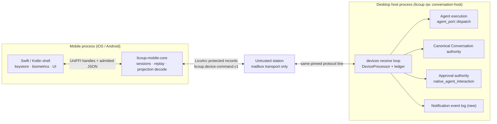
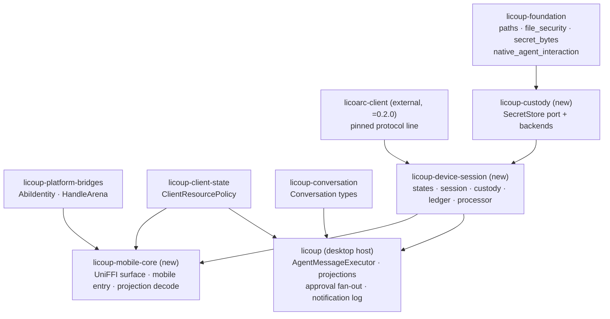

# Mobile Rust Core — Boundary Design

[Documentation](../README.md) · [Architecture](README.md) · [Architecture (zh-CN)](README.zh-CN.md)

| Field | Value |
|:---|:---|
| Status | Design proposal — not implemented |
| Updated | 2026-11-16 |
| Kanban task | `task_ll_u10_core_design` — 手机端 Rust 核心的边界设计 |
| Normative language | English (Normative) |
| Localization | Simplified Chinese projection not yet written |

This document designs the Rust core that the iOS (Swift) and Android (Kotlin)
clients link for the **first-version mobile scope**: pairing, viewing desktop
conversations, sending messages to a desktop Agent, handling approvals, and
system notifications. Agents run only on the desktop.

Every "exists today" claim below is anchored to a file and a type or function
in this repository at the time of writing. Everything else is marked
**must be added**. Nothing in this document was verified by running code; see
[§14](#14-verification-plan-not-executed).

---

## 0. Decisions at a glance

1. **One core, two shells, one authority.** The Rust core owns protocol
   sessions, replay admission, bounded request/projection shaping, and custody
   *handles*. The Swift/Kotlin shell owns the OS keystore, the biometric
   prompt, the UI, and process lifecycle. The desktop remains the only
   authority for conversations, Agent execution, approvals, and notification
   generation.
2. **The core is a small crate, not the desktop host.** `crates/licoup` is the
   desktop kernel (it depends on Agent drivers, parsers, gateway code, and
   process supervision). The mobile core must not link it. The device-session
   logic that already exists under `crates/licoup/src/domain/devices` is
   extracted into a shared crate that both sides compile.
3. **UniFFI generates the Swift and Kotlin control surface.** Handwritten C
   headers are rejected: the iOS bridging header already declares
   `lico_secure_mesh_*` symbols that no Rust target in this repository or in
   the LicoUp monorepo implements (see [§3.6](#36-mobile-repository-facts)).
4. **Payloads are versioned, schema-admitted JSON values; control is typed.**
   Handles, futures, subscriptions, lifecycle, custody callbacks, and errors
   are typed by UniFFI. Operation payloads are bounded JSON admitted against a
   per-operation schema and deserialized into typed domain values before use —
   never forwarded raw.
5. **No new wire, no second protocol.** The mobile core executes the same
   pinned Lico Arc Protocol Line through `licoarc-client` and speaks the same
   `licoup.device-command.v1` / `licoup.device-result.v1` records the desktop
   already speaks.

---

## 1. Scope

### 1.1 In scope for the first mobile version

| Capability | Mobile role | Desktop role |
|:---|:---|:---|
| Pairing | Claim an offer, hold its own device identity, confirm/unpair | Offer, confirm the claimed device, grant a capability scope |
| Conversation list / read | Render a bounded projection | Project from the Canonical Conversation authority |
| Message to a desktop Agent | Compose and send; consume streamed turn output | Admit once, execute the Agent, stream events and the terminal result |
| Approval decision | Render a parked request, gate with biometrics, answer once | Remain the approval authority; fan out and consume one decision |
| System notification | Present a local OS notification, maintain a cursor | Generate and retain durable notification events |

### 1.2 Out of scope

- Running any Agent, gateway, workflow, PTY, or provider process on the phone.
- A local Canonical Conversation store on the phone.
- History backup/recovery (`crates/licoup/src/domain/history_backup`) on the
  phone.
- Client-state migration, data-home relocation, plugin hosting, and MCP.
- Server-side push (APNs/FCM) and any notification delivery while the app is
  not running. See [§10.5](#105-notification-delivery).
- Media/attachment bytes. The phone receives attachment *metadata* only.
- Turning a station into a notification or approval service. Stations stay
  untrusted transport.

---

## 2. Topology and trust boundary



Trust rules, stated so they cannot be read as optional:

- The **station** is untrusted transport. It may drop, delay, reorder, or
  redeliver. It cannot read record plaintext. It never decides approvals,
  never authors notifications, and never becomes a push provider for the
  mobile OS.
- The **desktop** is the single authority for conversation content, Agent
  effects, approval outcome, and notification sequence. The phone never
  asserts any of these; it only *requests*, *renders*, and *answers*.
- The **phone** is a presentation and decision client with its own device
  identity and its own custody. A compromised phone must not be able to widen
  its own scope, mint approvals, or read conversations outside its granted
  scope.
- Approval, trust, local effects, and final effect evidence stay
  endpoint-local. A mobile approval is a *decision input* to the desktop's
  authority, never a replacement for it.

---

## 3. What exists today

This section is the reuse ledger. It separates modules that can carry the
mobile design from modules that only look reusable.

### 3.1 Device pairing, sessions, and replay — `crates/licoup/src/domain/devices`

| Item | Anchor | What it proves |
|:---|:---|:---|
| Group facade | `crates/licoup/src/domain/devices.rs` | `status`, `enroll`, `pair_offer`, `pair_claim`, `pair_cancel`, `unpair`, `message_send`, `message_results`, `sync` |
| Owner-only records | `domain/devices/state.rs` | `DevicesState`, `Enrollment`, `Peer`, `Pairing`; owner-only, bounded (`MAX_RECORD_BYTES`), atomic writes |
| Command payload | `domain/devices/command.rs` | `DeviceCommand`, `DeviceCommandResult`, `DeviceRecord`, `DeviceCommandLedger`, `execute_device_command` |
| Session composition | `domain/devices/session.rs` | `DeviceIdentity`, `ResponderSession`, `InitiatorSession`, `EstablishedSession`, `SessionRole`; LicoArc drives over custody-held keys |
| Secret custody | `domain/devices/custody.rs`, `domain/devices/session_custody.rs` | `DeviceKeyCustody`, `SessionCustody`: OS secret store, never data-home files |
| Durable endpoint state | `domain/devices/session_state.rs` | `SessionState`: sealed checkpoint, anti-rollback generation floor, custody-held integrity key |
| Delivery processor | `domain/devices/processor.rs` | `DeviceProcessor`, `PeerReceiver`, `OutEnvelope`; spool-first, exactly-once command execution, staged results |
| Host loop | `domain/devices/host.rs` | `ReceiveLoop`, `BridgedTransport`, `AgentMessageExecutor`; mailbox IO thread + thread-confined processing thread |
| Wire bounds | `command.rs` | `DEVICE_COMMAND_SCHEMA = "licoup.device-command.v1"`, `DEVICE_RESULT_SCHEMA = "licoup.device-result.v1"`, `MAX_PARAMS_BYTES = 1 MiB`, `MAX_ID_BYTES = 255` |
| Allowlist | `command.rs` | `AGENT_MESSAGE_SEND = "agent.message.send"`, `ALLOWED_COMMANDS`, `DENIED_PREFIXES` |

The command adapter is real, working, and narrow: exactly **one** command kind
is admitted today. `refusal()` rejects any other kind with
`command_not_allowlisted`, and `agent_message_params()` rejects any parameter
outside `AGENT_MESSAGE_SEND_FIELDS`. This is the right shape to extend and a
poor place to bolt on arbitrary RPC.

### 3.2 Command registration and desktop surface

| Item | Anchor | What it proves |
|:---|:---|:---|
| CLI admission table | `crates/licoup/src/ffi/commands/mod.rs` (`register_command` entries at `devices.rs`) | Paths: `devices status`, `devices enroll`, `devices pair offer`, `devices pair claim`, `devices pair cancel`, `devices unpair`, `devices sync`, `devices message send`, `devices message results` |
| Handlers | `crates/licoup/src/ffi/commands/devices.rs` | Thin projection onto `domain::devices` |
| Application envelope | `crates/licoup/src/ffi/commands/conversation_surface.rs` | `licoup.application-envelope/v1`, `status` is `ok` or `failed`, failure fields `code/stage/retryable/effect/recovery/field` |
| Conversation reads | `domain/conversations.rs`, `crates/licoup-application/src/facade.rs` | `conversation.list` / `conversation.get` through `ApplicationFacade` |
| Host requirement | `crates/licoup/src/domain/application_port.rs` | Reads fail closed with `persistent_conversation_transport_required`; no process-local store |
| Generated error | `crates/licoup/src/ffi/generated/client_error.rs` | `ClientError { code, stage, component, retryable, recovery, presentation_args }` |
| Registry | `crates/licoup/src/domain/client_authority_registry.rs` | `RuntimeAbi` owned by `licoup-platform-bridges`; `RuntimeSession`, `InteractionPolicy`, `ProtectedCommunication` owned by `licoarc-client` |

### 3.3 ABI and handle machinery — `crates/licoup-platform-bridges` and `domain/client_runtime`

| Item | Anchor | What it proves |
|:---|:---|:---|
| ABI identity | `crates/licoup-platform-bridges/src/abi.rs`, `resources/client_runtime_abi.json` | `AbiIdentity`, `CLIENT_RUNTIME_ABI_VERSION = 1`, closed operation list `runtime.create … shared_buffer.free` |
| Handle arena | `crates/licoup-platform-bridges/src/handle_arena.rs` | `HandleArena`, `Handle`, `ArenaError`; bounded, generation-indexed, stale-handle rejection, fail closed on generation wrap |
| Runtime state machine | `crates/licoup/src/domain/client_runtime/runtime.rs` | `ClientRuntime`: `create`, `destroy`, `spawn_future`, `complete_future`, `poll_future`, `cancel_future`, `free_future`, `subscribe`, `publish`, `drain_subscription`, `cancel_subscription`, `free_subscription`, shared buffers |
| Wake contract | `runtime.rs` | `WakeCallback = Arc<dyn Fn() + Send + Sync>`; wake carries no payload |
| Stream/cursor | `domain/client_runtime/stream.rs` | `StreamCursor`, `StreamItem`, `StreamQueue`, `LatestStateMerge`; dual-bounded, never truncates silently |
| Output spool | `domain/client_runtime/spool.rs` | `OutputSpool`; sealed process-local chunks, explicitly non-persistent |
| ABI errors | `domain/client_runtime/abi.rs` | `RuntimeError::code()` values `stale_handle`, `cancelled`, `capacity_exceeded`, … |
| Declared intent | `domain/client_runtime/mod.rs` | "Hosts later bind this surface through `licoup-platform-bridges`" |

This is the single most reusable asset for the mobile core: a bounded,
generation-safe, wake-only, non-truncating handle ABI already exists. What is
missing is an exported boundary and a host binding.

### 3.4 Secret custody ports — `core/secret_store` and `platform/secret_store`

| Item | Anchor | What it proves |
|:---|:---|:---|
| Port | `crates/licoup/src/core/secret_store/port.rs` | `trait SecretStore`: `supported`, `capability_facts`, `begin_authorized_session`, `set/get/delete_secret_with_session` |
| Authorization | `core/secret_store/authorization.rs` | `SecretStoreAuthorizationRequest`, `SecretStoreAuthorizationSession`, `SecretStorePresenceProvider`, `SecretStoreKeyClass`, `SecretStoreCallerChannel`, presence grants |
| Presence bounds | `authorization.rs` | `MAX_SECRET_STORE_PRESENCE_GRANT_TTL = 30s`, one-use `SecretStorePresenceGrant::consume`, replay/expiry codes |
| Secret material | `crates/licoup-foundation/src/core/secret_bytes.rs` | `SecretBytes` (bounded, zeroizing, redacted `Debug`), `MAX_SECRET_BYTES` |
| Handle validation | `core/secret_store/handle.rs` | `SecretStoreHandle`, namespace/key validation |
| Desktop backends | `platform/secret_store/platform_backends/{macos,linux,windows}.rs` | Real platform custody |
| Mobile backend | `platform/secret_store/platform_backends/unsupported.rs` | On `ios`/`android` the selected backend is **unsupported** and fails closed |
| Capability vocabulary | `core/security_capability/taxonomy.rs` | `SecurityCapability::AndroidKeystore`, `AppleKeychain`, `SecureEnclave`, `StrongBox`, `StrongBiometric`, `OsUserPresence`, … |

Two facts matter for the design:

- `SecretStoreCallerChannel::Mobile` **exists but is unused**.
  `SecretStoreKeyClass::PairwiseSession` and `GroupEpoch` **exist but are
  unused**; both device-key and session custody currently request
  `SecretStoreKeyClass::DeviceIdentity` with `SecretStoreCallerChannel::NativeCli`.
- iOS/Android cannot use custody today: the selected backend reports
  `supported() == false`, and `SecretStoreSelection::select` falls back to
  `EphemeralSecretStore`. A phone would lose its device key on restart.

### 3.5 Approvals and notifications

| Item | Anchor | What it proves |
|:---|:---|:---|
| Parked interaction registry | `crates/licoup-foundation/src/platform/native_agent_interaction/mod.rs` | `park_with_token`, `resolve`, `resolve_scoped`, `ResponseShape`, `InteractionRequest`; one-shot, in-memory, `MAX_PENDING_ROUTES = 256` |
| No production enumeration | same file | `pending_token`, `PendingRouteSnapshot`, `wait_for_pending_route` are `#[cfg(any(test, feature = "test-support"))]` only |
| Approval authority port | `crates/licoup-agent-drivers/src/acp_session_transport/approval_port.rs` | `ApprovalPort { evaluate_request, evaluate_fanout }`, installed once, fail-closed when uncomposed |
| Desktop composition | `crates/licoup/src/platform/runtime_adapters.rs` | `evaluate_approval_request` validates `pendingOperationId`, `adapterCallbackTokenRef`, `responseNonce` |
| Fan-out today | `runtime_adapters.rs` | `evaluate_approval_fanout` returns `"targets": []` with the comment "Approval fan-out to paired devices is not offered" |
| Turn events | `crates/licoup-foundation/src/platform/turn_event_emit.rs` | `install_stream_sink`, `emit_turn_event`, `emit_agent_message_chunk`; **thread-local**, one sink per synchronous dispatch, redacted events |
| Notification infrastructure | — | **None.** No APNs/FCM/push code exists in the workspace (searched: `apns`, `fcm`, `UNUserNotification`, `NotificationManager`). |

### 3.6 Mobile repository facts

Read-only inspection of the sibling repositories:

**`../LicoUp-iOS`** (branch `main`, not modified)

- `Runner/SecureMeshIosBridge.swift` implements a Flutter `MethodChannel`
  (`licoup.secure_mesh.ios`) with `status`, `writeRuntimeStatus`, and
  `nativeJson`.
- `nativeJson` calls `lico_secure_mesh_json_with_secret_store(request_json,
  files_dir, callbacks)` and `lico_secure_mesh_string_free`.
- `Runner/Runner-Bridging-Header.h` declares
  `lico_secure_mesh_runtime_self_test`, `lico_secure_mesh_runtime_feature_flags`,
  `lico_secure_mesh_runtime_protocol_hash`, `lico_secure_mesh_json`,
  `lico_secure_mesh_json_with_secret_store`, `lico_secure_mesh_string_free`, and
  the `LicoSecureMeshSecretStoreCallbacks` struct.
- `Runner/SecureMeshIosBridge+SecretStore.swift` uses Keychain with
  `kSecAttrAccessibleWhenUnlockedThisDeviceOnly` and
  `kSecAttrAccessibleAfterFirstUnlockThisDeviceOnly`.
- `Runner/SecureMeshIosBridge+LocalAuth.swift` uses `LAContext` with
  `.deviceOwnerAuthentication`, a `.userPresence` access control, and a
  single shared system authorization context.
- `Runner/LocalOnlyDataProtection.swift` creates protected Application Support
  roots and excludes the obsolete portable root from backup.
- `README.md` expects `liblicoup_native.a` per target
  (`ios-arm64`, `ios-simulator-arm64`, `ios-simulator-x64`) staged from
  LicoUp-CLI artifacts.

**`../LicoUp-Android`** (branch
`refactor/android-native-compose-shell`, not modified)

- Standalone Gradle/Kotlin/Compose shell: `MainActivity`, `ui/LicoUpApp.kt`,
  `ui/theme/Theme.kt`, one Compose smoke test.
- `MIGRATION-NOTES.md` records that **every** `SecureMeshAndroid*` file, the
  `licoup.secure_mesh.android` MethodChannel, `ReleaseClosureBinding`, the
  `stageSecureMeshAndroidNative` task, `liblicoup_native.so` packaging, and
  `System.loadLibrary` were removed, and that the channel "is retired" and
  "must not be restored as-is".
- `AndroidManifest.xml` sets `android:allowBackup="false"`; backup rules
  exclude every domain; `network_security_config.xml` sets
  `cleartextTrafficPermitted="false"` except `localhost`/`127.0.0.1`.

**Cross-repository finding.** In this branch of LicoUp-CLI there is **no**
`#[no_mangle]`/`#[unsafe(export_name)]` symbol, no `lico_secure_mesh_*`
implementation, and no mobile cross-compilation tooling
(`cargo ndk`, `aarch64-apple-ios`, `aarch64-linux-android`, XCFramework
scripts: all absent). A read-only search of `../LicoUp`
also finds no `lico_secure_mesh` implementation. The iOS bridging header and
its `liblicoup_native.a` contract therefore describe a boundary that **does not
exist in either repository today**.

### 3.7 Removed prior art (not present on this branch)

Commit `28eb069` ("Ship the single licoup binary and its publishable crate
closure (0.3.1)") deleted `crates/licoup-mobile-core`, `crates/licoup-native`,
and `crates/licoup-native/src/core/secure_mesh*.rs`. That removed crate is the
closest prior art and is cited here **only as history**, never as an existing
module:

- `licoup-mobile-core/src/lib.rs` declared `delivery`, `entry`, `group_bridge`,
  `host`, `identity`, `read_model`, `settings`, `surface`, and stated the
  scope rule this document keeps: the mobile client "does not run Agents, does
  not host the gateway, does not execute workflows".
- `surface.rs` declared a closed `MOBILE_SURFACE` with `SurfaceGroup::{Pairing,
  Delivery, Group}` and an explicit `DESKTOP_ONLY_OPERATIONS` list.
- `read_model.rs` defined `ChatCard`, `ChatList`, `ThreadView`, `EventView`,
  `MemberView` over the Canonical Conversation types.
- `identity.rs` defined `MOBILE_REQUIRED_CUSTODY` and refused **staged**
  custody for durable writes (`IdentityRefusal::TentativeCustody`), a rule this
  design preserves.
- `Cargo.toml` set `crate-type = ["rlib", "cdylib", "staticlib"]` and
  `publish = false`.

Its operation names (`mobile.relay.*`, `licoup-endpoint-core`,
`licoup-protocol-bindings`) are retired and must not be revived. What is worth
reviving is the *shape*: a narrowly scoped, separately compiled crate with a
dependency-closure test that fails if desktop-only crates leak in.

### 3.8 `history_backup` — deliberately not on the mobile path

`crates/licoup/src/domain/history_backup/` is provider-neutral retained-history
backup and recovery: `AuthorizedHistoryStore`, `ManifestSegment`,
`seal_history_object`/`open_history_object`, `RecoveryOwner`,
`recover_replacement_endpoint`, `RecoveryMaterial`. It is **not** a
conversation-sync channel and must not be repurposed as one:

- It is provider-authorized and provider-managed; the mobile core has no
  provider authorization.
- Its recovery flow is a replacement-device flow with a fresh-session
  requirement and one atomic caller-owned commit — unrelated to viewing a
  conversation from a paired phone.
- The mobile first version reads conversations from the **desktop
  projection**, not from a backup object.

---

## 4. State ownership

### 4.1 Owned by the Rust core

| State | Today | Mobile core |
|:---|:---|:---|
| Device identity key material | OS secret store via `DeviceKeyCustody` | Same, through the shell custody callback |
| Device identity descriptor | `identity.json`, tokens + publics only | Same, inside the app sandbox |
| Enrollment record | `enrollment.json` (station, mailbox id, invitation) | Same, **invitation moved into custody** (§7.5) |
| `Peer` / `Pairing` tables | `state.rs` | Same, plus capability scope |
| Session endpoint directories | `client-state/devices/sessions/<dir>` | Same, under the shell-provided root |
| Session checkpoint + generation floor | `SessionState` | Same |
| Command ledger | `DeviceCommandLedger` (`commands.sqlite3`) | Same |
| Packet spool | `licoarc_client::Spool` under `devices/spool` | Same |
| Replay / idempotency decisions | `execute_device_command`, `record_outbound`, `record_result` | Same |
| Request admission and bounds | `DeviceCommand::from_value`, `MAX_PARAMS_BYTES` | Same, plus the mobile envelope bounds |
| Future/subscription handles | `ClientRuntime` | Same |
| Notification cursor | — | **Must be added** |
| Conversation projection decode + device-local redaction | — | **Must be added** |

### 4.2 Owned by the platform shell

| Responsibility | iOS | Android |
|:---|:---|:---|
| Keychain/Keystore reads and writes | `SecItem*` | `KeyStore` / `EncryptedSharedPreferences` |
| User-presence prompt | `LAContext.evaluatePolicy(.deviceOwnerAuthentication)` | `BiometricPrompt` (or device-credential fallback) |
| Sandbox root selection | `Application Support/LicoUp/secure-mesh` (`LocalOnlyDataProtection`) | `filesDir` / `noBackupFilesDir` |
| File protection / backup exclusion | `NSFileProtection`, `isExcludedFromBackup` | `allowBackup=false`, `dataExtractionRules` |
| App lifecycle signals | `scenePhase`, `applicationDidEnterBackground` | `ProcessLifecycleOwner`, `onStop` |
| OS notification presentation | `UNUserNotificationCenter` | `NotificationCompat` + channel |
| Permission prompts | only on the action that needs them | only on the action that needs them |
| All UI, navigation, formatting, locale | ✓ | ✓ |
| `clientIntentId` generation | UUID v4 before the call | UUID v4 before the call |

### 4.3 Owned by the desktop

- Canonical Conversation store, event ordering, membership, and the only
  `EventPage` cursor authority.
- Agent selection, executable binding, turn execution, output, and the
  conversation write path.
- The approval authority: `ApprovalPort::evaluate_request`,
  `ApprovalPort::evaluate_fanout`, and the one-shot
  `native_agent_interaction::resolve_scoped` consumption.
- Notification event generation, sequencing, and retention.
- Pairing confirmation and capability grants.
- Station invitation minting (outside this repository; see
  [§14](#14-verification-plan-not-executed), Q2).

### 4.4 Resolved ambiguities

| Question | Resolution |
|:---|:---|
| Who decides which conversations the phone may read? | The desktop, at pairing and later via an explicit scope edit. The phone may narrow, never widen. |
| Who assigns the notification sequence? | The desktop. The phone only advances an ack cursor. |
| Who owns "the turn is still running"? | The desktop. The phone renders the last event it received and a `stale` marker after a heartbeat gap. |
| Who formats timestamps and titles? | The core transports RFC3339/Unix-ms values; the shell formats and localizes. |
| Who generates pairing codes? | The desktop. The phone parses and claims. |
| Who generates `clientIntentId`? | The shell generates it; the core persists the intent→command mapping before any send. |

---

## 5. Core operation surface

### 5.1 Envelope and bounds

All core calls use one versioned envelope, mirroring the existing
`licoup.application-envelope/v1` status vocabulary:

```json
{
  "schema": "licoup.mobile-core.v1",
  "version": 1,
  "operation": "conversation.read",
  "requestId": "req-<uuidv4>",
  "clientIntentId": "ci-<uuidv4>",
  "params": {}
}
```

Success:

```json
{
  "schema": "licoup.mobile-core.v1",
  "version": 1,
  "requestId": "req-…",
  "status": "ok",
  "result": {}
}
```

Failure:

```json
{
  "schema": "licoup.mobile-core.v1",
  "version": 1,
  "requestId": "req-…",
  "status": "failed",
  "error": {
    "code": "mobile_scope_denied",
    "stage": "device/admission",
    "component": "native_cli",
    "retryable": false,
    "recovery": "correct_request",
    "presentationArgs": { "field": "capability" }
  }
}
```

Bounds:

| Bound | Value | Source |
|:---|:---|:---|
| Request bytes | 2 MiB | same bound as `MAX_CLI_ARGUMENT_BYTES` in `ffi/commands/mod.rs` |
| Operation name | 128 bytes | new; matches the retired mobile entry's `MAX_MOBILE_ACTION_BYTES` |
| Peer command params | 1 MiB | `MAX_PARAMS_BYTES` in `domain/devices/command.rs` |
| Peer command id | 255 bytes | `MAX_ID_BYTES` in `domain/devices/command.rs` |
| Record plaintext | 524 224 bytes | `licoarc::protection::MAX_PLAINTEXT_BYTES` (transitive via `licoarc-client`; not a direct workspace dependency) |
| Packet | 524 288 bytes | `licoarc::transport::MAX_PACKET_BYTES` (transitive via `licoarc-client`) |
| Conversation page | 50 events | `ClientResourcePolicy::standard().bounds().history_page_size` |
| Handle arena | 256 per kind | `DEFAULT_HANDLE_CAPACITY` in `domain/client_runtime/runtime.rs` |

`requestId` is the correlation identity for one caller action. `clientIntentId`
is the *effect* identity: a retry after a timeout must reuse it. Operations
that have no effect (`core.status`, `conversation.list`, `conversation.read`)
accept but ignore `clientIntentId`.

### 5.2 Local operations (no peer)

| Operation | Request params | Result | Errors | Idempotency |
|:---|:---|:---|:---|:---|
| `core.status` | `{}` | `{ abiVersion, schema, enrolled, mailboxId?, peers[], pairings[], openSessions, lifecycle }` | `core_not_ready` | pure read |
| `core.enroll` | `{ station, invitation, ca? }` | `{ enrolled: true, mailboxId }` | `devices_station_invalid`, `devices_invitation_invalid`, `devices_already_enrolled`, `devices_station_*`, `devices_device_key_store_unsupported` | intent-keyed; a second enroll on an enrolled home is refused, never re-keyed |
| `pairing.claim` | `{ code, label? }` | `{ pairingId, state }` | `devices_pairing_code_invalid`, `devices_not_enrolled`, `devices_station_*` | intent-keyed; the same `clientIntentId` returns the same `pairingId` |
| `pairing.status` | `{ pairingId? }` | `{ pairings[], peers[] }` | `devices_pairing_not_found` | pure read |
| `pairing.cancel` | `{ pairingId }` | `{ ok: true }` | `devices_pairing_not_found`, `devices_pairing_completed` | idempotent: cancelling an already-removed pairing returns `ok` |
| `pairing.unpair` | `{ peerId }` | `{ ok: true }` | `devices_peer_not_found` | idempotent |
| `session.open` | `{ peerId, resumeCursor? }` | `{ sessionId, peerId, state }` | `devices_peer_not_found`, `core_lifecycle_suspended` | one open session per peer; a second call returns the same `sessionId` |
| `session.close` | `{ sessionId }` | `{ ok: true }` | `stale_handle` | idempotent |
| `session.lifecycle` | `{ state: "foreground"\|"background"\|"terminate" }` | `{ state, peerSessions[] }` | `invalid_state` | last writer wins; monotonic transitions only |

`core.enroll` and `pairing.claim` reuse the existing bodies in
`domain/devices.rs` (`enroll_in`, `pair_claim_prepare`, `pair_claim`). What is
new on mobile is (a) the invitation goes to custody, not `enrollment.json`,
(b) the request is intent-keyed, and (c) the claim may end in a
desktop-confirmation wait instead of immediate completion.

### 5.3 Peer commands: mobile → desktop

A peer command is one `licoup.device-command.v1` record inside a LicoArc
session record. The sender's identity is the session's trust fact, never a
payload field — this invariant from `command.rs` is preserved.

#### 5.3.1 `conversation.list` (must be added)

```json
{
  "includeArchived": false,
  "limit": 50,
  "cursor": null
}
```

Result (`DeviceCommandResult.output`):

```json
{
  "commandKind": "conversation.list",
  "output": {
    "conversations": [
      {
        "id": "conv-…",
        "title": "…",
        "archived": false,
        "pinned": false,
        "isGroup": true,
        "revision": 42,
        "updatedAtUnixMs": 1763300000000,
        "membershipCount": 3,
        "eventCount": 120,
        "memberAgentIds": ["codex"],
        "hasLocalOwner": true
      }
    ],
    "nextCursor": "opaque",
    "truncated": false
  }
}
```

The field set deliberately mirrors `ConversationSummary` in
`crates/licoup-conversation/src/client_conversation/mod.rs`; it adds nothing and
infers nothing. `truncated` exists so the phone can page rather than guess.

Errors: `mobile_scope_denied`, `persistent_conversation_transport_required`,
`device_command_invalid`, `command_not_allowlisted`.

Idempotency: pure read. A redelivered command returns a fresh page; the phone
deduplicates by `id` and `revision`.

#### 5.3.2 `conversation.read` (must be added)

```json
{
  "conversationId": "conv-…",
  "beforeSequence": null,
  "limit": 50
}
```

Result:

```json
{
  "commandKind": "conversation.read",
  "output": {
    "conversationId": "conv-…",
    "events": [
      {
        "id": "evt-…",
        "sequence": 120,
        "authorMembershipId": "membership:owner",
        "kind": "message",
        "createdAtUnixMs": 1763300000000,
        "finalized": true,
        "parts": [
          { "id": "part-…", "ordinal": 0, "kind": "text", "content": "…", "createdAtUnixMs": 1763300000000 }
        ]
      }
    ],
    "nextBeforeSequence": 71,
    "hasEarlier": true,
    "totalCount": 120
  }
}
```

This mirrors `EventPage`, `ConversationEvent`, and `EventPart`.

**Projection rules (binding):**

- The same canonical part kinds are projected; the mobile path does not
  invent a second display vocabulary. `EventPartKind::{Text, Reasoning,
  ToolCall, ToolResult, Artifact, Diagnostic, Metadata, Image}` all travel.
- **Device-local locators never travel.** `ImageAttachment.path` (an absolute
  local path inside the `Image` part's JSON content) is replaced with an
  opaque `attachmentId` plus `name`, `mediaType`, `byteSize`. The phone shows
  a placeholder; it never receives a desktop filesystem path.
- Tool-call arguments are conversation content and stay in the projection,
  but any nested absolute path that the adapter itself injected is treated
  the same way as `ImageAttachment.path`.
- No event is cut. If one event cannot fit a record, the desktop answers
  `mobile_projection_too_large` naming the `eventId`, and the phone asks for
  that event with `conversation.readPart` (phase 2, must be added).

Errors: as above plus `conversation_not_found` (new).

Idempotency: pure read; deduplicate by `(conversationId, sequence)`.

#### 5.3.3 `agent.message.send` (exists as a command; new as a mobile flow)

Params admitted today by `agent_message_params()`:

```json
{
  "agent": "codex",
  "text": "…",
  "sessionId": "optional-native-session",
  "model": "optional",
  "reasoningEffort": "optional"
}
```

The core adds `idempotencyKey` (= `commandId`) before handing params to the
executor. `DENIED_EXECUTION_FIELDS` continues to reject `command`, `args`,
`cwd`, `env`, `binaryPath`, `timeoutMs`, `maxStdoutBytes`, and friends.

**Semantic change required for mobile.** Today `execute_device_command()`
calls `executor.execute()` inline and returns the *settled* turn output as one
`DeviceCommandResult`. Measured against the protocol, that is wrong for a
phone: `conversation_lane::send_and_settle()` blocks for the whole turn, the
single processing thread is occupied, and the result can exceed
`MAX_PLAINTEXT_BYTES` without any bound.

The mobile flow is therefore split into three commands:

| Command | Direction | Payload | Meaning |
|:---|:---|:---|:---|
| `agent.message.send` | phone → desktop | params above | Admit exactly once; answer fast |
| `agent.turn.event` | desktop → phone | `{ turnId, conversationId, sequence, event }` | Ordered progress |
| `agent.turn.result` | desktop → phone | `{ turnId, partIndex, partCount, final, chunk }` | Terminal output, chunked, never truncated |

`agent.message.send` result:

```json
{
  "commandKind": "agent.message.send",
  "output": { "accepted": true, "turnId": "turn-…", "conversationId": "conv-…" }
}
```

Idempotency: `clientIntentId` → `commandId` is recorded by
`message_send_prepare_in()` **before** the send; a retry with the same intent
returns the same `commandId` and never mints a second execution. A redelivered
command in state `admitted` returns the same `{accepted, turnId}`.

Errors: all `native_agent_*` codes from `AgentDispatchFailure::from_adapter_code`,
plus `agent_binding_required`, `agent_message_text_required`,
`unscoped_execution_field`, `command_field_not_enabled`,
`native_agent_runtime_binding_unavailable`.

#### 5.3.4 `approval.answer` (must be added)

The desktop fans out `approval.request`; the phone answers with exactly one
decision.

`approval.request` (desktop → phone):

```json
{
  "approvalRequestId": "apr-…",
  "adapterId": "hermes",
  "sessionId": "…",
  "turnId": "…",
  "method": "session/request_permission",
  "summary": "Allow the Agent to run the test command?",
  "options": ["allow", "deny"],
  "responseShape": "approval",
  "expiresAt": "2026-11-16T12:00:00Z"
}
```

`approval.request` result (phone → desktop): `{ "presented": true }` after the
request is durably stored and the local notification is posted. The phone does
not block the command on the user.

`approval.answer` (phone → desktop):

```json
{
  "approvalRequestId": "apr-…",
  "decision": "allow",
  "answeredAt": "2026-11-16T11:59:30Z",
  "presence": { "method": "biometric", "at": "2026-11-16T11:59:29Z" }
}
```

Result:

```json
{
  "commandKind": "approval.answer",
  "output": { "recorded": true, "decision": "allow", "decidedAt": "2026-11-16T11:59:31Z" }
}
```

Rules:

- `presence` is **advisory metadata**, never authority. The desktop does not
  parse it as a grant. The biometric gate is enforced by the phone's own OS
  before the record is sent; the desktop records *which paired device*
  answered.
- `responseShape` other than `approval`/`confirm` (that is, `select`, `input`,
  `editor`) is **not** answerable from a phone in v1. The desktop must not fan
  it out.
- The desktop maps `approvalRequestId` to the parked route token and calls
  `native_agent_interaction::resolve_scoped(token, Some(sessionId),
  Some(turnId), {"allow": <bool>})`. The route is consumed once; a second
  answer cannot re-decide.
- If the route is gone, the desktop answers `approval_request_unknown` (no
  decision recorded).
- A repeated `approval.answer` with the same `approvalRequestId` and the same
  decision returns the recorded outcome (`recorded: true`) and is a no-op. A
  different decision returns `approval_already_decided` with the recorded
  decision and changes nothing.

Errors: `approval_request_unknown`, `approval_already_decided`,
`approval_response_invalid`, `approval_expired`, `mobile_scope_denied`,
`native_interaction_route_consumed`, `native_interaction_scope_mismatch`.

#### 5.3.5 `notification.subscribe` / `notification.ack` / `notification.unsubscribe` (must be added)

`notification.subscribe`:

```json
{ "subscriptionId": "sub-…", "since": 0, "kinds": ["turn", "approval", "conversation"], "limit": 64 }
```

Result:

```json
{
  "subscriptionId": "sub-…",
  "cursor": 0,
  "retainedFrom": 0,
  "latest": 42
}
```

`notification.event` (desktop → phone):

```json
{
  "subscriptionId": "sub-…",
  "sequence": 42,
  "kind": "approval",
  "conversationId": "conv-…",
  "turnId": "turn-…",
  "approvalRequestId": "apr-…",
  "contentFree": true,
  "titleKey": "notification.approval.title",
  "bodyKey": null,
  "occurredAt": "2026-11-16T11:59:00Z"
}
```

Rules:

- The default event is **content-free**: a localization key, not a message
  excerpt. A conversation may opt in to a preview, which is then bounded to
  240 characters and generated on the desktop.
- `notification.ack` `{ subscriptionId, sequence }` → `{ cursor }`. The cursor
  is monotonic; acking below the current cursor is a no-op that returns the
  current value.
- If `since < retainedFrom`, the desktop answers `notification_lag_exceeded`
  with `retainedFrom`; the phone resets its cursor and refreshes the
  conversation list instead of silently skipping events.
- `notification.unsubscribe` → `{ ok: true }`, idempotent.

Idempotency: one subscription per `(peerId, subscriptionId)`; re-subscribing
with the same id and cursor returns the same cursor and does not duplicate.
Delivery is at-least-once; the phone deduplicates by `(peerId, sequence)`.

#### 5.3.6 Capability admission

Every peer command is admitted by three checks, in this order:

1. **Paired** — `device_peer_not_paired` if not.
2. **Direction and scope** — the peer's granted capability set must contain
   the command kind with the matching direction. Otherwise
   `mobile_scope_denied`.
3. **Shape** — the per-kind field allowlist, the `MAX_PARAMS_BYTES` bound, and
   (for approvals) the one-shot approval ledger.

Today only step 1 and a global kind allowlist exist in `refusal()`; there is no
per-peer scope. That is the first must-add seam ([§10.1](#101-device-session-establishment-and-scope)).

### 5.4 ABI-level operations (existing `ClientRuntime`)

These are not new operations; they are the lifetime model the UniFFI surface
wraps:

| Operation | Method | Notes |
|:---|:---|:---|
| `runtime.create` | `ClientRuntime::create` | one live runtime per core |
| `runtime.destroy` | `ClientRuntime::destroy` | drops all outstanding handles, closes Agent IPC |
| `future.poll` | `ClientRuntime::poll_future` | `None` = pending, `Err(Cancelled)` = cancelled |
| `future.complete` | `ClientRuntime::complete_future` | late completion after cancel is linearized, no-op |
| `future.cancel` | `ClientRuntime::cancel_future` | drops result and wake |
| `future.free` | `ClientRuntime::free_future` | stale afterwards |
| `subscription.drain` | `ClientRuntime::drain_subscription` | cursor + limit |
| `subscription.cancel` | `ClientRuntime::cancel_subscription` | idempotent |
| `subscription.free` | `ClientRuntime::free_subscription` | stale afterwards |
| `shared_buffer.free` | `ClientRuntime::free_shared_buffer` | |

Wake callbacks are wake-only. A wake tells the shell "poll or drain"; it never
carries payload, so no conversation text or secret crosses the callback.

---

## 6. Idempotency and replay

### 6.1 The existing ledger, verbatim

`DeviceCommandLedger` (`domain/devices/command.rs`) owns three tables:

- `inbound_command(peer_id, command_id, fingerprint, state, result_json,
  recorded_at)` with `PRIMARY KEY (peer_id, command_id)` and
  `state IN ('reserved','completed')`.
- `outbound_command(client_intent_id PRIMARY KEY, command_id UNIQUE, peer_id,
  created_at)`.
- `command_result(command_id PRIMARY KEY, peer_id, status, output_json,
  completed_at)`.

Semantics already implemented and to be preserved:

| Situation | Behaviour | Code |
|:---|:---|:---|
| Redelivered completed command | Returns the recorded result, does not execute | — |
| Same `(peer, command_id)` with different fingerprint | Refused, no execution | `command_replay_conflict` |
| Redelivered command whose earlier run was interrupted | Refused, outcome unknown | `execution_outcome_unknown` |
| Result for a command never sent to that peer | Refused | `device_result_unsolicited` |
| Duplicate result record | `INSERT OR IGNORE`, no-op | — |
| Same `clientIntentId` for a different peer | Refused | `devices_client_intent_conflict` |
| Same `clientIntentId` for the same peer | Returns the original `commandId`, sends nothing | — |

The fingerprint is `SHA-256` over canonical `{commandKind, params}`, so any
parameter drift under one command id is a conflict, not a retry.

### 6.2 Rules per mobile operation

| Operation | Effect identity | Replay answer | Retention |
|:---|:---|:---|:---|
| `core.enroll` | `clientIntentId` | same result, no re-key | enrollment record lifetime |
| `pairing.claim` | `clientIntentId` | same `pairingId`, no second session dir | pairing row lifetime |
| `pairing.cancel` / `pairing.unpair` | target id | `ok` | n/a |
| `agent.message.send` | `clientIntentId` → `commandId` | same `{accepted, turnId}` | ledger lifetime |
| `agent.turn.result` | `(turnId, partIndex)` | duplicate part ignored | turn retention on desktop |
| `approval.answer` | `approvalRequestId` | same decision → recorded outcome; different → `approval_already_decided` | approval ledger lifetime |
| `notification.subscribe` | `(peerId, subscriptionId)` | same cursor | subscription row lifetime |
| `notification.ack` | `(peerId, subscriptionId, sequence)` | monotonic; lower ack is a no-op | subscription row lifetime |
| `conversation.list` / `conversation.read` | none | fresh read; client dedupes | none |

### 6.3 Ledger changes required

1. **Third state for asynchronous commands.** Widen the `inbound_command`
   state to `('reserved','admitted','completed')`. `admitted` means "the
   effect was accepted; its outcome travels on the turn result stream". A
   redelivery in `admitted` returns the stored admission result. A process
   restart while `admitted` requires reconciliation from the conversation
   store before any result is emitted — the client vocabulary already has
   `RecoveryAction::ReconcileBeforeRetry` for exactly this class.
2. **Schema migration.** `CHECK` constraints cannot be altered in place.
   `DeviceCommandLedger::open` must run an idempotent, versioned migration
   (`PRAGMA user_version`): create the new table, copy, drop, rename, inside a
   transaction. The ledger currently has no version marker.
3. **Approval fan-out ledger (new durable table).** The parked-route registry
   is in-memory (`OnceLock<Mutex<RouteRegistry>>`) and bounded at 256 pending
   routes with 1 024 remembered ids. A phone may answer minutes later, across
   a desktop restart. Add `approval_fanout(approval_request_id PRIMARY KEY,
   peer_id, route_token, session_id, turn_id, request_digest, state, decision,
   created_at, expires_at)` with `state IN ('pending','answered','cancelled',
   'expired')`. It stores the opaque route token; it never stores the route's
   response channel.
4. **Outbound intent race.** `message_send_prepare_in()` reads
   `outbound_command(client_intent_id)` and then inserts, on a fresh
   connection, without a transaction. Two concurrent callers using one intent
   can both pass the read and one insert fails on the primary key. Change the
   insert to `INSERT OR IGNORE` plus a follow-up read, or wrap read+insert in
   one transaction. On mobile, also serialize intent handling on the core
   queue ([§9](#9-threading-model)).
5. **Result enumeration bound.** `DeviceCommandLedger::results(peer_id, since)`
   returns every row and has no limit. Mobile reads must use a bounded query
   (`LIMIT` + cursor). Do not reuse the unbounded projection.

---

## 7. Key custody and secret hygiene

### 7.1 Port shape

Reuse `trait SecretStore` unchanged. The mobile shell implements it through a
UniFFI callback interface:

```rust
#[uniffi::export(with_foreign)]
pub trait MobileCustodyHost: Send + Sync {
    fn backend(&self) -> String;                 // "ios-keychain" | "android-keystore"
    fn supported(&self) -> bool;
    fn authorize(&self, request: CustodyAuthorization) -> PresenceDecision;
    fn set_secret(&self, namespace: String, key: String, secret: Vec<u8>) -> Result<(), CustodyError>;
    fn get_secret(&self, namespace: String, key: String) -> Result<Option<Vec<u8>>, CustodyError>;
    fn delete_secret(&self, namespace: String, key: String) -> Result<(), CustodyError>;
}
```

`Vec<u8>` is copied across the FFI boundary. The Rust side must wrap it in
`SecretBytes` (which zeroizes on drop and redacts `Debug`), and the shell must
zero the buffer it handed over. The existing iOS callback contract already
does this with `bytes_zeroize_and_free`, and the existing Swift report asserts
`secretMaterialCrossesFlutterMethodChannel = false`; the new path must keep
that property for the UniFFI boundary too.

### 7.2 Custody classes and where each lives

| Material | Store item | Key class | Notes |
|:---|:---|:---|:---|
| Mailbox device seed (32 bytes) | `devices:<home>` / `mailbox-device-key` | `DeviceIdentity` | `DeviceKeyCustody`; minted once at enrollment |
| Session custody table (signing keys, staged/adopted agreement keys, checkpoint integrity key) | `devices:session:<home>` / `custody` | `PairwiseSession` | `SessionCustody`; one item per endpoint; `destroy()` removes every trace |
| Station invitation / admission token | **must move here** | `GatewayCredential` or a new class | See §7.5 |
| Session checkpoint | `<session>/endpoint.checkpoint` | integrity key in custody | Sealed; `0600`; restore is MAC-checked |
| Endpoint scope | `<session>/endpoint.scope` | not secret | Stable per endpoint; created once |
| Generation floor | `<session>/endpoint.generation` | not secret | Anti-rollback high-water mark |

### 7.3 Biometric gate

The gate is a **presence grant**, not a password prompt, and it is one flow per
user action:

1. The core builds one `SecretStoreAuthorizationRequest::for_scope(reason,
   operation_count, allow_interaction = true, key_class,
   SecretStoreCallerChannel::Mobile)`.
2. The shell evaluates `LAContext` (`.deviceOwnerAuthentication`) or
   `BiometricPrompt` once and returns `PresenceDecision::{Approved, Cancelled,
   TimedOut}`.
3. The core issues one-use `SecretStorePresenceGrant`s from the approved batch
   (`MAX_SECRET_STORE_PRESENCE_GRANT_TTL = 30s`), consuming one per store
   operation and failing closed on replay or expiry.

This is exactly the desktop contract already implemented in
`platform/secret_store/macos_user_presence.rs` and modeled by
`SecretStoreApprovedPresenceBatch`. The shell must not implement its own
"remember for 5 minutes" cache; the only valid grant life is the one the core
issued.

Two small corrections while doing this:

- Session custody should request `SecretStoreKeyClass::PairwiseSession`, not
  `DeviceIdentity`. The enum variant already exists and is unused; the change
  makes the prompt reason truthful and separates device-identity keys from
  per-peer session keys.
- `SecretStoreCallerChannel::Mobile` exists and is unused; every mobile request
  must use it, so a shared audit path can distinguish channels.

New enum variants are required in `SecretStorePresenceProvider`
(`IosKeychain`, `AndroidKeystore`); today only macOS, Linux, and Windows exist.

### 7.4 Secrets must never appear in

- **Request or result payloads.** No command kind carries a key, seed,
  invitation, or custody table. `agent_message_params()` already rejects
  `secrets.`-prefixed kinds and `secrets.` is in `DENIED_PREFIXES`.
- **Plaintext files.** The device seed and the session custody table live only
  in the OS store. `identity.json`, `peers.json`, `pairings.json`, and the
  ledger carry identifiers and public descriptors only. The station invitation
  is the one exception in the current tree and must move into custody
  (§7.5).
- **Logs and diagnostics.** `SecretBytes`, `SecretStorePresenceNonce`,
  `SecretStorePresencePurpose`, `SecretStorePresenceBatchRequest`,
  `SecretStorePresenceScope`, `SecretStoreApprovedPresenceBatch`,
  `SecretStorePresenceGrant`, and `SecretStoreConsumedPresence` all implement
  `Debug` as `REDACTED`. New mobile types must follow the same rule and must
  not derive `Debug` when they hold `SecretBytes`.
- **Notifications.** `notification.event` carries localization keys by
  default. It never carries a message excerpt, a tool argument, a path, or an
  approval token.
- **Crash reports and analytics.** The core must not depend on an analytics or
  crash-reporting crate; the shell must not attach core buffers to a report.

### 7.5 Finding: the station invitation is a plaintext credential today

`Enrollment { station, invitation, mailbox_id, enrolled_at }` is written by
`DevicesState::write_enrollment()` through `atomic_write_private_text()` into
`client-state/devices/enrollment.json`. The `invitation` is a `btm1.` bearer
admission token: `credentials()` passes it to `licoarc_client::Credentials`,
whose `token` field is `Zeroizing<String>` precisely because the protocol
treats it as a secret.

This contradicts the stated boundary in
[`SECURITY-AND-DATA-BOUNDARY.md`](SECURITY-AND-DATA-BOUNDARY.md), which puts a
"Relay access token" in platform secret custody. It is `0600` and
owner-directory protected, but it is still a plaintext file.

Decision required (this design assumes "fix"):

- **Mobile (must):** the invitation is written to the OS store at enrollment
  and only a locator (`station`, `mailbox_id`) is kept in `enrollment.json`.
- **Desktop (should follow):** migrate the existing invitation into the same
  custody item on next start, and delete it from the JSON. Until migrated, the
  desktop remains a plaintext-token store, and the mobile design must not
  claim otherwise.

### 7.6 File protections the core must request

The core never chooses an absolute root. The shell passes a `files_dir` on
open — the same contract the retained iOS ABI already had
(`lico_secure_mesh_json(request_json, files_dir, callbacks)`), because an iOS
sandbox container path is not stable and must not be baked into custody
namespaces.

The core then applies the existing helpers from
`licoup_foundation::platform::file_security`:

- `ensure_private_dir` for the devices root and every session directory.
- `atomic_write_private_text` / `atomic_write_private_text_bounded` for the
  records.
- `read_private_text_bounded` with the existing `MAX_RECORD_BYTES = 1 MiB`.
- `0600` on unix, plus the shell's own protection (iOS file protection and
  backup exclusion; Android `noBackupFilesDir`).

**Custody namespace must not be derived from the absolute path.**
`DeviceKeyCustody::for_devices_dir()` and `SessionCustody::open()` both hash
`dir.to_string_lossy()` into the store namespace. On iOS the container path can
change; on Android the app data path can change across restore. A path-derived
namespace would orphan every stored key. The core must derive the namespace
from a stable, shell-supplied application identifier plus a logical endpoint
name, and must treat the path as a locator only.

---

## 8. Binding generation and crate layout

### 8.1 Recommendation: UniFFI, proc-macro mode

**Use [UniFFI](https://mozilla.github.io/uniffi-rs/) in proc-macro mode to
generate the Swift and Kotlin control surface, with one core crate and one
generated binding artifact per platform.**

Reasons, grounded in this repository:

1. **One authority.** The repository already forbids hand-edited generated
   contracts and requires both sides to regenerate from one source. UniFFI
   makes Rust the single source for records, enums, errors, object lifetimes,
   and callback interfaces.
2. **Two platforms, one description.** A handwritten C ABI needs a header
   (`Runner-Bridging-Header.h`), JNI glue, and Kotlin `external fun`
   declarations — three hand-maintained artifacts. That is exactly the drift
   already observed: the iOS header declares `lico_secure_mesh_*` symbols that
   no target implements.
3. **The lifetime model already matches.** `ClientRuntime` is a handle table
   with explicit free and wake-only callbacks. UniFFI objects with
   `poll`/`drain`/`cancel`/`free` methods wrap it without changing the ABI
   identity in `licoup-platform-bridges`.
4. **Callback interfaces cover custody.** `MobileCustodyHost` is a natural
   UniFFI `with_foreign` trait; a C ABI needs a struct of function pointers
   plus manual `ctx` lifetime, which is what the retained iOS bridge does and
   what the Android side dropped.
5. **No second schema.** UniFFI derives from Rust items. The alternative —
   extending `schemas/client_bridge/manifest.json` with `swiftOutput` and
   `kotlinOutput` and writing a new generator — adds a fourth generator to
   maintain and still needs a hand-written C/JNI shim underneath.

Rejected alternatives:

| Alternative | Why rejected |
|:---|:---|
| Handwritten C ABI + cbindgen | Header/JNI/Kotlin drift; the existing iOS header is already stale; no Kotlin generation |
| Extend the `client_bridge` schema generator to Swift/Kotlin | Still needs a hand-written native shim; duplicates UniFFI's object/error/callback model |
| JSON-only single entry (`lico_secure_mesh_json`) | Untyped control surface, no handle lifetimes, no cancellation, and it is the exact boundary that disappeared |
| Flutter MethodChannel on mobile | Android retired it explicitly; mobile has no Flutter host in the target architecture |

Adopting UniFFI is a **new third-party build dependency**. It must pass the
repository's dependency and license review before implementation; UniFFI is
MPL-2.0, and the compatibility of that with this repository's
AGPL-3.0-or-later distribution must be confirmed rather than assumed (see
[§14](#14-verification-plan-not-executed), Q1).

### 8.2 What is typed and what is admitted JSON

| Layer | Mechanism |
|:---|:---|
| Core lifetime (`open`, `close`, `lifecycle`) | UniFFI object methods |
| Futures, subscriptions, shared buffers | UniFFI objects wrapping `Handle` |
| Wake | UniFFI callback interface `CoreWake { fn wake(&self); }` |
| Custody | UniFFI callback interface `MobileCustodyHost` |
| Errors | `#[derive(uniffi::Error)] enum MobileCoreError` mapping `ClientError` and `RuntimeError::code()` |
| Operation payloads | Bounded JSON values, admitted against `schemas/client_bridge/mobile_core.json`, then deserialized into typed Rust structs before any use |

The JSON payload decision is deliberate and consistent with the repository's
rule against *unvalidated* pass-through: every payload is size-bounded,
schema-validated, converted to a typed value, and never forwarded to another
channel as raw text. This is the same pattern `DeviceRecord::decode` already
uses for the wire.

### 8.3 Crate layout



New crates:

| Crate | Contents | Rule |
|:---|:---|:---|
| `crates/licoup-custody` | Extracted `core/secret_store`, `platform/secret_store` (desktop backends behind `cfg`, mobile host backend), `core/security_capability`, `foundation::core::secret_bytes` | No network, no process spawn, no Agent code |
| `crates/licoup-device-session` | Extracted `domain/devices/{state,command,session,session_custody,session_state,processor}` and the mailbox machinery of `host` (`ReceiveLoop`, `BridgedTransport`, `OutWork`), **not** `AgentMessageExecutor` | Must not depend on `licoup`, Agent drivers, gateways, or Flutter |
| `crates/licoup-mobile-core` | UniFFI exports, mobile entry/admission, projection decode, notification cursor, `crate-type = ["cdylib","staticlib"]`, `publish = false` | Must not depend on `licoup` |

Extraction is mechanical but not trivial: `domain/devices` currently reaches
`crate::core::secret_store`, `crate::platform::secret_store`,
`crate::domain::targets` (only in `host.rs::AgentMessageExecutor`), and
`crate::agent_port` (also only there). The two secret-store modules move to
`licoup-custody`; `domain::targets` and `agent_port` must **not** enter the
shared crate at all. `AgentMessageExecutor` stays in `licoup`, and the executor
port remains a trait in `licoup-device-session`.

Add a dependency-closure test that walks the workspace manifests and fails if
`licoup-mobile-core`'s closure contains `licoup`, any `licoup-agent-*`,
`licoup-workflow*`, `licoup-private-gateway`, `licoup-public-gateway`, or
`tokio`'s process features. The retired crate had exactly this test
(`tests/dependency_closure.rs`); re-add it.

### 8.4 Versioning

| Identity | Value | Change rule |
|:---|:---|:---|
| `CLIENT_RUNTIME_ABI_VERSION` | `1` | Existing; unchanged |
| `layoutIdentity` | `licoup.client-runtime.abi.v1.generation-index` | Existing; unchanged |
| `MOBILE_CORE_ABI_VERSION` (new) | `1` | New resource `crates/licoup-platform-bridges/resources/mobile_core_abi.json` |
| `layoutIdentity` (mobile) | `licoup.mobile-core.abi.v1.uniffi-handle` | New |
| Envelope | `licoup.mobile-core.v1` | Additive fields only within v1; a breaking change is v2 |
| Device wire | `licoup.device-command.v1` / `licoup.device-result.v1` | Unchanged; new command kinds are additive |
| State records | `RECORD_SCHEMA_VERSION = 1` | Keep 1; new fields use `#[serde(default)]`, and absence means "legacy", never "grant everything" |
| Ledger | new `PRAGMA user_version` | Must be added for the `admitted` state migration |

A shell whose `MOBILE_CORE_ABI_VERSION` does not match the linked core must
refuse to open the core and show a blocking "update the app" state. There is
no downgrade path: an older core reading newer state must fail closed, and the
records' `deny_unknown_fields` already provides that for the JSON tables.

### 8.5 Build and packaging (must be added)

Nothing in this workspace builds a mobile artifact today. Required additions:

- `cargo ndk` (or equivalent) targets: `aarch64-linux-android`,
  `armv7-linux-androideabi`, `x86_64-linux-android`; `aarch64-apple-ios`,
  `aarch64-apple-ios-sim`, `x86_64-apple-ios`.
- `uniffi-bindgen generate --library <artifact> --language swift|kotlin
  --out-dir bindings/<lang>`.
- An XCFramework assembly step producing the artifact the iOS repository
  already expects, replacing the name `liblicoup_native.a` with the actual
  crate output (`liblicoup_mobile_core.a`) and updating
  `scripts/build-secure-mesh-native.sh` in the iOS repository accordingly.
- A Gradle/Variants packaging step for `.so` per ABI, and **restoring** a JNI
  load path in the Android shell (the current tree has none by design).
- Artifact size and symbol checks, plus a check that no `licoup` desktop
  symbol is present in the mobile library.

Both mobile repositories must be updated in the same change as the core's
first release; leaving the iOS header pointing at nonexistent symbols is the
current failure mode.

---

## 9. Threading model

### 9.1 Ownership

One `MobileCore` instance owns one `ClientRuntime`, one `DevicesState`, one
mailbox connection, and one **serialized command queue**. Rust session state
is thread-confined: `SessionCustody` holds `Rc<RefCell<Table>>` and
`SessionState` holds `Rc<RefCell<Versioned<…>>>`, so neither is `Send`. The
existing desktop loop already respects this by owning the processor on a
dedicated thread (`licoup-devices-process`) and keeping the async mailbox half
on a separate Tokio runtime (`licoup-devices-receive`). The mobile core keeps
the same split.

### 9.2 Rules

| Rule | Detail |
|:---|:---|
| Who may call | Any shell thread may call the UniFFI object, but every call only enqueues work and returns a `FutureHandle` or `SubscriptionHandle`. |
| Where work runs | One core thread owns all session/custody/ledger state. Mailbox I/O runs on a Tokio multi-thread runtime owned by the core. |
| Never block the main thread | No UniFFI method performs network or disk work inline. `poll` and `drain` are non-blocking reads of already-computed state. |
| Callback thread | Wake callbacks are invoked through a shell-provided executor. `ClientRuntime`'s wake is `Arc<dyn Fn() + Send + Sync>`; the shell hops to its own actor (`DispatchQueue.main` / `Dispatchers.Main`) and then polls. |
| Re-entrancy | A wake callback must not call back into the core synchronously. The core must not invoke a wake while holding its internal mutex; `ClientRuntime` is `&mut self`, so the binding wraps it in a `Mutex` and releases it before waking. |
| Per-peer serialization | At most one session driver per peer directory per process. `EstablishedSession::open` reopens and persists the same directory; two concurrent drivers would fork the checkpoint. Enforce with a per-peer mutex keyed by `session_dir`. |
| Command ordering | Commands to one peer are sent in admission order. The current `DeviceProcessor::send_record` + `drain_outbound` path is ordered; keep it. |
| Result ordering | `agent.turn.event` and `agent.turn.result` carry a per-turn `sequence`/`partIndex`; the phone reorders and drops duplicates. |

### 9.3 Cancellation

| What | How | Notes |
|:---|:---|:---|
| A pending local call | `future.cancel(handle)` | Sets `FutureState::Cancelled`; late completion is a no-op |
| A subscription | `subscription.cancel(handle)` then `free` | Cancelled drain returns `RuntimeError::Cancelled` |
| App lock / termination | `session.lifecycle("terminate")` | Cancels every future and subscription, closes the mailbox, drops the runtime |
| A running desktop turn | **Not supported in v1** | The device command model has no cancel kind. Must be added as `agent.turn.cancel` (`agent_port::cancel` exists) before the UI offers a cancel button |
| A queued approval | Desktop expiry or `pairing.revoke` | The phone shows "expired on desktop" |

### 9.4 Background and foreground

`session.lifecycle` is the only lifecycle input the core trusts:

| Transition | Core action |
|:---|:---|
| → `background` | Stop reconnecting, finish the in-flight record, persist the checkpoint, close the mailbox socket. Keep no timer. |
| → `foreground` | Reconnect with the existing policy: initial 250 ms, doubling to 60 s, jittered (`host.rs::jittered`); drain pending outbound; re-subscribe notifications from the stored cursor. |
| → `terminate` | Cancel everything, persist, drop the runtime. |

No background execution is promised. iOS gives a short window after
backgrounding and may suspend the process at any time; Android Doze and app
standby defer work. `CONTINUOUS-ASSISTANT.md` states the same rule for the
desktop: "An OS timer is not a guarantee of background execution." The mobile
design must not build a feature that assumes otherwise.

Consequences to state in the UI:

- Notifications arrive only while the process is alive and the session is
  connected. A killed app shows nothing until the next launch, when the phone
  re-subscribes from `retainedFrom` and renders the backlog.
- `OutputSpool` is process-local and non-persistent; queued turn output does
  not survive a restart. The durable record is the desktop conversation, which
  the phone re-reads on resume.
- Approvals are time-bounded. If the phone was suspended past `expiresAt`, the
  desktop has already refused or cancelled; the desktop emits the resolution as
  a `notification.event` with `kind: "approval"` and the same
  `approvalRequestId`, and the phone reconciles its pending list by that id on
  resume.

---

## 10. Desktop-side capabilities to add

Each row names the existing anchor and the new seam. New file paths are
proposals scoped to `crates/licoup/src/domain/devices/` unless noted.

### 10.1 Device session establishment and scope

**Exists today**

- Enrollment: `devices enroll` → `enroll_in()` (station URL, `btm1.`
  invitation, optional CA).
- Offer/claim: `devices pair offer` → `pair_offer_in()` (`ResponderSession::issue_offer`,
  one-hour validity, monotonic `next_pair_sequence()`); `devices pair claim` →
  `pair_claim()` (`pair_claim_prepare()` + `InitiatorSession::begin`).
- Acceptance: `DeviceProcessor::accept_claim()` authenticates a claim, mints a
  session handle, creates the `Peer`, stores the reply, and marks the pairing
  `completed` **immediately**.
- Completion: `DeviceProcessor::finish_claim()` verifies the reply and records
  the peer.
- Session listing: `devices status`.
- Revocation: `devices unpair` → `unpair_in()` destroys the session dir,
  removes pairings, removes the peer, and forgets outbound intents.

**Must be added**

1. **Desktop confirmation of a claim.** Split `accept_claim()`:
   - `authenticate_claim()`: run the responder's claim authentication, persist
     `state = "awaiting-confirmation"`, the claimer identity, the minted reply,
     and the staged session dir; create **no** peer row and **no** forged
     completion.
   - `confirm_claim(pairing_id, capabilities)`: create the `Peer`, set
     `capabilities`, mark `completed`, set `reply_pending = true`.
   - `decline_claim(pairing_id)`: set `state = "declined"`, drop the staged
     session dir, answer `pairing_declined` to a redelivered claim.
   Redelivery while `awaiting-confirmation` must be idempotent on the
   `(pairing_id, claimer_identity_digest)` pair and must not mint a second
   session handle. After `completed`, keep the existing behaviour: re-answer
   the stored reply, never re-accept.

2. **Capability scope on the pairing and peer records.**
   Add to `Peer` and `Pairing`:

   ```rust
   #[serde(default)]
   pub(crate) capabilities: Vec<String>,
   #[serde(default)]
   pub(crate) push_capabilities: Vec<String>,
   ```

   Closed set, serialized kebab-case:

   | Capability | Direction | Command kind |
   |:---|:---|:---|
   | `conversation-list` | peer → desktop | `conversation.list` |
   | `conversation-read` | peer → desktop | `conversation.read` |
   | `agent-message-send` | peer → desktop | `agent.message.send` |
   | `approval-answer` | peer → desktop | `approval.answer` |
   | `notification-subscribe` | peer → desktop | `notification.subscribe`/`ack`/`unsubscribe` |
   | `approval-request` | desktop → peer | `approval.request` |
   | `notification-event` | desktop → peer | `notification.event` |
   | `turn-event` | desktop → peer | `agent.turn.event` |
   | `turn-result` | desktop → peer | `agent.turn.result` |

   **Legacy rule:** an absent or empty `capabilities` on an already-paired peer
   means exactly `["agent-message-send"]` — the only command that existed.
   Never interpret absence as "grant everything", and never auto-add a new
   capability to an existing peer. A new capability requires an explicit
   desktop action.

3. **Scope admission.** Replace the global-only check in `refusal()` with the
   per-peer check described in [§5.3.6](#536-capability-admission). Keep
   `DENIED_PREFIXES` as a second, independent refusal.

4. **Desktop commands.** `device.session.describe`,
   `device.session.scope.set`, `device.session.revoke` registered in
   `ffi/commands/mod.rs` and handled in `ffi/commands/devices.rs`, with new
   `domain::devices` functions.

5. **Mutual unpair.** Today `unpair` is local-only. Add a `pairing.revoke` peer
   command so the other side removes the peer and destroys the session; until
   then, a phone-side unpair leaves the desktop believing the lane is live.

**Acceptance:** a claim cannot become a peer without a desktop decision; a
legacy peer cannot invoke a new command; a scope reduction takes effect on the
next command without restarting the receive loop.

### 10.2 Conversation projection

**Exists today**

- `conversation.list` / `conversation.get` through `ApplicationFacade` and
  `domain/application_port.rs`.
- `Conversation`, `ConversationSummary`, `ConversationEvent`, `EventPart`,
  `EventPage` in `crates/licoup-conversation`.
- The durable host requirement (`persistent_conversation_transport_required`).
- `conversation_surface.rs`'s envelope vocabulary.

**Must be added**

- `crates/licoup/src/domain/devices/projection.rs`:
  - `project_conversation_list(params) -> Value` over `ConversationSummary`.
  - `project_conversation_read(params) -> Value` over `EventPage`.
  - `redact_device_local_locators(value) -> Value` for `ImageAttachment.path`
    and adapter-injected absolute paths.
  - A page-size reducer that never splits an event: if the projected page
    exceeds `MAX_PLAINTEXT_BYTES - 1024`, drop whole events from the tail and
    set `hasEarlier`/`nextBeforeSequence` accordingly.
- Two new allowlisted command kinds, `conversation.list` and
  `conversation.read`, with their own field allowlists in `command.rs`.
- A `conversation.changed` push (desktop → phone) carrying
  `{ conversationId, revision }` only, so the phone can invalidate its cache
  without a full re-read. Without it the phone polls, which wastes radio and
  battery.
- `conversation_not_found` and `mobile_projection_too_large` codes.

The projection is executed on the device processing thread and reaches the
conversation host through `conversation_host_client::execute_existing`, which
opens its own local stream per call. It must not open a second
`ConversationService`; the `application_port` rule already forbids that.

**Acceptance:** no absolute path ever appears in a projected payload; a
conversation with an over-large single event yields an explicit
`mobile_projection_too_large` with the `eventId`, and no content is cut.

### 10.3 Message send

**Exists today**

- Payload and admission: `DeviceCommand::agent_message`,
  `agent_message_params`, `execute_device_command`.
- Exactly-once binding: `message_send_prepare_in` + `DeviceCommandLedger`.
- Desktop execution: `AgentMessageExecutor` resolves the runtime executable via
  `domain::targets::available_runtime_executable` and calls
  `agent_port::dispatch("send", &params)`.
- Settlement: `conversation_lane::send_and_settle` produces
  `nativeSessionId`/`sessionId`/`turnId` and settlement deltas.

**Must be added**

1. **Asynchronous admission.** Change the `agent.message.send` execution path
   from "settle inside the delivery" to:
   - reserve the command (`reserved`),
   - hand it to a bounded turn worker,
   - record `admitted` with `{turnId, conversationId}`,
   - return the admission result,
   - emit `agent.turn.event` and `agent.turn.result` when the turn produces
     them.
   The existing synchronous `execute_device_command` stays for every other
   command kind; the async path is a second function
   (`admit_device_command`) that shares the ledger and the refusal policy.
2. **Ordered turn streaming.** Install a turn-event sink on the turn worker
   (`turn_event_emit::install_stream_sink`) and forward
   `emit_turn_event`/`emit_agent_message_chunk` payloads as `agent.turn.event`
   records. The sink is thread-local and one-per-thread, so each turn worker
   must run one turn at a time, or use one worker per concurrent turn with a
   bounded pool.
3. **Chunked terminal result.** `agent.turn.result` carries
   `{ turnId, partIndex, partCount, final, chunk }`, with chunks sized so the
   encoded record stays below `MAX_PLAINTEXT_BYTES`. The result is never
   truncated; the phone appends incrementally to its own bounded store and
   discards chunks after rendering if it needs the space.
4. **Reconciliation.** On restart, any `admitted` command is reconciled from
   the conversation store before a terminal result is re-emitted; if the turn
   cannot be found, answer `execution_outcome_unknown` with
   `recovery = reconcile_before_retry` rather than re-running the Agent.
5. **Per-conversation ordering.** Two sends to the same conversation must not
   interleave turns. Serialize on `conversationId` and answer `turn_in_flight`
   for a second concurrent send, or queue it explicitly.

**Acceptance:** a phone send returns in bounded time independent of turn
length; a redelivered send never runs the Agent twice; a 5 MiB agent reply is
delivered completely in chunks.

### 10.4 Approval stream

**Exists today**

- `native_agent_interaction` parks a one-shot route with a token, validates
  `{"allow": bool}` for `Approval`/`Confirm`, and consumes once.
- `ApprovalPort::evaluate_request` and `evaluate_fanout` are installed by
  `runtime_adapters::install()`.
- `evaluate_approval_fanout` returns an empty target list by design.

**Must be added**

1. **A production observer.** `pending_token`, `PendingRouteSnapshot`, and
   `wait_for_pending_route` are test-only. Add production
   `native_agent_interaction::subscribe_parked(listener)` or
   `list_pending()` plus a wake, so the fan-out owner can learn about a park
   without polling the test helpers.
2. **Fan-out targets.** Change `evaluate_approval_fanout` to return the paired
   peers whose `push_capabilities` contain `approval-request`, filtered by
   conversation scope and by a policy that the desktop user has enabled. Keep
   the fail-closed contract: an unevaluable target list is empty, never "all".
3. **Durable fan-out ledger.** `approval_fanout` (§6.3) maps
   `approvalRequestId` to the route token. It must store the token, not the
   channel, and must record the first decision atomically.
4. **Request emission.** On park, write the ledger row, then send
   `approval.request` to each target. On a target failure, keep the row and
   retry on the next drain; the desktop's own UI remains able to answer.
5. **Decision consumption.** On `approval.answer`, verify
   `(peerId, approvalRequestId)` and the stored digest, then call
   `resolve_scoped(token, session_id, turn_id, {"allow": decision == "allow"})`.
   Record the decision before replying, so a crash between consume and reply
   replays the same outcome instead of double-deciding.
6. **Desktop-side display.** The desktop UI must show "waiting for phone" and
   keep its own answer path. A phone decision and a desktop decision race;
   `resolve_scoped` consumes once, so exactly one wins and the loser reads
   `native_interaction_route_consumed`. The loser must not retry with the
   opposite decision.

**Acceptance:** exactly one decision is consumed per park; a decision after a
desktop restart is either applied to the same park or refused with
`approval_request_unknown`; no response shape other than `approval`/`confirm`
is ever fanned out.

### 10.5 Notification delivery

**Exists today:** nothing. `turn_event_emit` is an in-process, thread-local
sink; there is no durable event log and no push channel.

**Must be added**

1. **`notification_log` (new, durable).** SQLite under the devices directory
   with `(sequence INTEGER PRIMARY KEY AUTOINCREMENT, peer_id, kind,
   conversation_id, turn_id, approval_request_id, content_free, payload_json,
   occurred_at)` and a per-peer cursor table. Sequence is global and monotonic;
   each peer reads its own projection.
2. **Generator.** Emit on: turn started/finished/failed, approval parked,
   approval decided, conversation revision changed. Payloads are bounded and
   content-free by default.
3. **Retention.** Bound by `ClientResourcePolicy::standard().bounds()
   .spool_queue_events` (1 024) and a byte quota. When the log evicts,
   `retainedFrom` advances; a phone behind that point gets
   `notification_lag_exceeded` and must refresh.
4. **Delivery.** A per-peer pump that sends `notification.event` records on
   the peer's session, respecting the phone's ack cursor and the session's
   ordering. It must not build an unbounded in-memory queue.
5. **System presentation (phone, must be added).** The shell maps each event
   to `UNMutableNotificationContent` / `NotificationCompat.Builder` with a
   localization key and a deep link. No message text by default.

If product later requires notifications while the app is terminated, that is a
**new delivery channel** with its own privacy review: APNs/FCM tokens are
third-party identifiers, the payload must be content-free and encrypted or
opaque, and a station must never be used as the push provider. That work is
explicitly outside this design.

**Acceptance:** a killed phone loses no durable event (it catches up from
`retainedFrom`); a locked-screen notification reveals no conversation text by
default; the desktop's log survives restart and keeps monotonic sequence.

### 10.6 Desktop operational precondition

The device receive loop starts only in the `licoup rpc conversation-host`
process (`crates/licoup/src/bin/licoup.rs`): "The one persistent host per data
home owns the enrolled device's mailbox connection for its lifetime". If the
desktop app is not running that host, the phone has no peer. The mobile UX
must surface "desktop offline" from the transport outcome, not from an
application-level timeout.

---

## 11. Threat model and residual risk

| Threat | Control | Residual |
|:---|:---|:---|
| Stolen unlocked phone answers an approval | Per-answer biometric via `LAContext`/`BiometricPrompt`; desktop records the answering device; approval request shows adapter, session, and summary; short expiry | A coerced user can still approve. The desktop UI shows the decision source. |
| Phone requests a conversation outside its scope | Per-peer capability and conversation scope checked on every command in `refusal()` | Scope edits are a desktop action; a compromised desktop is out of scope |
| Phone asks the desktop to run a shell command | `DENIED_PREFIXES`, per-kind field allowlists, `AgentDispatchFailure` classification; `binaryPath` is resolved by the desktop, never supplied by the phone | A malicious *Agent* is a separate trust boundary |
| Replay of an approval or a send | `DeviceCommandLedger` fingerprint + one-shot `resolve_scoped` + `approval_fanout` state | At-least-once delivery means the phone must tolerate duplicates |
| Station tampers with a notification | Notifications are generated by the desktop; the station only carries records. The phone authenticates the session and rejects replayed sequences | A station can delay or drop; it cannot forge a record |
| Downgrade to an older core | `MOBILE_CORE_ABI_VERSION` equality check; state `deny_unknown_fields`; no silent default for capabilities | An old *app* with an old core can still be installed by the user |
| Secret leakage through logs/crash reports | Redacted `Debug`, `SecretBytes`, zeroizing types; no analytics dependency in the core; no secret in any payload | Shell-side crash handlers must be reviewed separately |
| Path traversal from a peer-supplied id | Ids are bounded to 255 bytes and used as opaque keys; session directories are named by the core, never by a peer | — |
| Approval request used as a content exfiltration channel | `summary` is adapter-generated and display-bounded; `approval.request` carries no tool arguments, no paths, no file content | The summary itself may quote a command; that is the desktop's decision |
| Notification as a content leak on the lock screen | Content-free by default; preview opt-in per conversation; bounded to 240 characters | User-enabled previews are visible on a locked screen |
| Reentrancy deadlock in the binding | Wake never called while the core mutex is held; wake-only callbacks; no synchronous re-entry | A buggy shell can still deadlock itself |

---

## 12. Compatibility and migration

| Area | Rule |
|:---|:---|
| Existing peers | Absent capabilities = `["agent-message-send"]`. No automatic grant. |
| Existing `enrollment.json` | Reads as today. On mobile, the invitation is moved to custody at enroll time. Desktop migration is a separate, explicit step (§7.5). |
| Existing ledger | Migrate with `PRAGMA user_version`; the `admitted` state is additive. Results already recorded stay readable. |
| Existing pairing states | `awaiting-claim`, `awaiting-reply`, `completed` remain; `awaiting-confirmation` and `declined` are new. A pairing in an unknown state fails closed (`devices_state_invalid`). |
| Retired `mobile-relay` state | Never read, migrated, or deleted; `devices status` continues to report `legacyPairingsDetected` only. |
| iOS `lico_secure_mesh_*` header | Must be replaced in the same change as the first core release. The old symbols are not implemented anywhere; leaving the header is a link-time failure waiting for a build. |
| Android bridge | Must be reintroduced deliberately with the new ABI; the retired `licoup.secure_mesh.android` channel must not be restored. |
| Old app + new desktop | New command kinds are simply not offered to a peer without the capability; an old phone never sees them. |
| New app + old desktop | The phone must degrade: `command_not_allowlisted` and `mobile_scope_denied` produce a "desktop update required" state, not a crash. |

---

## 13. Rollout phases

1. **Phase 0 — extraction.** Create `licoup-custody` and
   `licoup-device-session`; move code without behaviour change; add the
   dependency-closure test; desktop tests stay green.
2. **Phase 1 — mobile custody and ABI.** Implement the mobile `SecretStore`
   backend, `SecretStorePresenceProvider` variants, the namespace fix, and the
   UniFFI surface for `core.status`/`core.enroll`/`pairing.*`.
3. **Phase 2 — pairing with scope.** Desktop confirmation, capability scope,
   `device.session.*`, mutual revoke.
4. **Phase 3 — conversation projection.** `conversation.list`/`read`,
   `conversation.changed`, redaction, page sizing.
5. **Phase 4 — message send.** Async admission, turn event/result streaming,
   reconciliation.
6. **Phase 5 — approvals.** Production park observer, durable fan-out,
   `approval.request`/`approval.answer`, phone biometric gate.
7. **Phase 6 — notifications.** Durable log, subscription pump, local OS
   presentation, retention and lag handling.
8. **Phase 7 — packaging and release.** XCFramework, Gradle ABI packaging,
   both mobile repositories updated, version gates.

Each phase ships a usable increment: pairing alone is useful; conversation
read alone is useful; send without approvals is useful; approvals without
notifications still work in-foreground; notifications without push are honest.

---

## 14. Verification plan (not executed)

Nothing in this document was verified by running code. The following must be
built and run before implementation is claimed complete.

**Rust**

- Ledger migration test: v0 table → v1 table, with results preserved.
- Replay tests per command kind: duplicate, conflicting fingerprint,
  interrupted (`reserved`), admitted, unsolicited result.
- Projection tests: `ImageAttachment.path` absent; page never splits an
  event; over-large single event yields `mobile_projection_too_large`.
- Bounds tests: 2 MiB request, 1 MiB params, 255-byte id, 524 224-byte
  plaintext.
- Custody tests: invitation only in the store; namespace stability across a
  changed `files_dir`; one-use presence grant; replay and expiry refused.
- Async send: admission returns before the turn settles; redelivery does not
  re-run the Agent; a 5 MiB result arrives complete.
- Approval: exactly one `resolve_scoped` succeeds per park; the loser reads
  `native_interaction_route_consumed`; restart recovery.
- Dependency closure: `licoup-mobile-core` does not reach `licoup` or any
  Agent/gateway crate.
- UniFFI round-trip and error mapping for every exported method.
- Zeroization probes for every secret-carrying type.

**Swift / Kotlin**

- Generated bindings compile against the pinned Xcode/Gradle toolchains.
- Face ID / Touch ID / BiometricPrompt approve, cancel, and timeout paths.
- Keychain/Keystore survives app restart and rejects an inaccessible item.
- Background → foreground reconnects and catches up from `retainedFrom`.
- Local notification content is content-free by default.
- No secret appears in an OS log, a crash report, or a snapshot.

**Cross-repository**

- The iOS project links the new artifact and no longer references
  `lico_secure_mesh_*`.
- The Android project links the new `.so` and has an explicit, reviewed load
  path.
- Both shells pass the same operation-contract fixtures.

Repository gates to run only after implementation, not for this document:
`client:gate:source`, the selected Rust lane, and the affected Android lane.
This document changes documentation only.

---

## 15. Open questions and unverified claims

1. **UniFFI license and supply chain.** MPL-2.0 compatibility with this
   repository's AGPL-3.0-or-later distribution, the exact crate set it pulls
   in, and whether the repository will accept it as a build dependency.
   Unverified.
2. **Station invitation minting.** A one-scan "pair my phone" flow needs the
   desktop to obtain a single-use phone invitation. No such capability exists
   in this repository; whether the station product that issues `btm1.`
   invitations can mint one on the desktop's behalf is unverified. Until then,
   the phone enrolls with its own invitation and then claims the desktop
   offer.
3. **Whether the desktop host is always running.** The receive loop lives in
   `licoup rpc conversation-host`. Whether the shipping desktop app keeps that
   host alive while the app is open, and what "open" means for approvals, is a
   product decision not settled here.
4. **`agent_port::dispatch("send")` result shape stability.** The streamed
   result field names (`nativeSessionId`, `sessionId`, `turnId`) were read
   from `conversation_lane::send_and_settle`; the full lane response schema was
   not exhaustively verified.
5. **`licoarc-client` internal guarantees.** The plaintext and packet bounds
   were read from the `licoarc 0.2.0` sources in the local Cargo registry, which
   `licoarc-client 0.2.0` depends on;
   `licoarc` itself is **not** a direct dependency of this workspace (only
   `licoarc-client = "=0.2.0"` is declared in `Cargo.toml`). These are external
   dependency facts, not repository facts, and are subject to that crate's
   release.
6. **iOS container-path stability.** The claim that the Application Support
   path can change is a general iOS platform behaviour, not verified against a
   specific install/update sequence in this repository.
7. **`RunnerTests` coverage.** The iOS test bundle was not read in detail; the
   tests may already assert bridge behaviour that the new ABI must preserve.
8. **Android Keystore specifics.** `minSdk = 26` and the available
   `BiometricPrompt`/`StrongBox` matrix were read from the manifest and build
   file, not validated on a device.
9. **`native_agent_interaction` lifetime.** Routes are in-memory and have no
   expiry by design ("There is deliberately no elapsed-time expiry"). The
   `expiresAt` field in this design is a new product constraint and must not be
   confused with the registry's own lifetime.
10. **Whether `conversation.list` should include archived conversations by
    default.** The desktop CLI exposes `--include-archived`; the mobile default
    (`false`) is a product choice.
11. **Retention quotas.** The exact notification-log byte quota and the
    approval-fanout retention window are not decided.
12. **No tests were run and no build was performed for this document.**

---

## Appendix A. Exists-today index

| Path | Symbol | Used for |
|:---|:---|:---|
| `crates/licoup/src/domain/devices.rs` | `status_in`, `enroll_in`, `pair_offer_in`, `pair_claim_prepare`, `pair_claim`, `pair_cancel_in`, `unpair_in`, `message_send_prepare_in`, `message_send`, `message_results_in`, `sync` | Pairing and send facade |
| `crates/licoup/src/domain/devices/state.rs` | `DevicesState`, `Enrollment`, `Peer`, `Pairing`, `RECORD_SCHEMA_VERSION` | Durable records |
| `crates/licoup/src/domain/devices/command.rs` | `DeviceCommand`, `DeviceCommandResult`, `DeviceRecord`, `DeviceCommandLedger`, `execute_device_command`, `agent_message_params`, `AgentDispatchFailure` | Wire, replay, admission |
| `crates/licoup/src/domain/devices/session.rs` | `DeviceIdentity`, `ResponderSession`, `InitiatorSession`, `EstablishedSession`, `device_line`, `encode_offer_code` | LicoArc pairing and sessions |
| `crates/licoup/src/domain/devices/session_custody.rs` | `SessionCustody` | Session keys in the OS store |
| `crates/licoup/src/domain/devices/session_state.rs` | `SessionState` | Sealed checkpoint and anti-rollback |
| `crates/licoup/src/domain/devices/processor.rs` | `DeviceProcessor`, `PeerReceiver`, `OutEnvelope`, `drain_outbound` | Delivery processing |
| `crates/licoup/src/domain/devices/host.rs` | `ReceiveLoop`, `BridgedTransport`, `AgentMessageExecutor`, `start` | Mailbox loop and Agent execution |
| `crates/licoup/src/domain/devices/custody.rs` | `DeviceKeyCustody`, `DEVICE_KEY_USER_PRESENCE_ENV` | Mailbox key custody |
| `crates/licoup/src/domain/client_runtime/` | `ClientRuntime`, `HandleArena`, `StreamQueue`, `OutputSpool`, `RuntimeError` | Handle/stream ABI |
| `crates/licoup-platform-bridges/` | `AbiIdentity`, `HandleArena`, `CLIENT_RUNTIME_OPERATIONS` | ABI identity |
| `crates/licoup/src/core/secret_store/` | `SecretStore`, authorization, presence grants, `SecretBytes` | Custody port |
| `crates/licoup/src/platform/secret_store/` | `PlatformSecretStore`, backend selection | Desktop backends |
| `crates/licoup/src/core/security_capability/taxonomy.rs` | `SecurityCapability` | Capability vocabulary |
| `crates/licoup/src/platform/runtime_adapters.rs` | `evaluate_approval_request`, `evaluate_approval_fanout`, `install` | Approval authority |
| `crates/licoup-foundation/src/platform/native_agent_interaction/mod.rs` | `park_with_token`, `resolve_scoped`, `ResponseShape` | Parked approvals |
| `crates/licoup-foundation/src/platform/turn_event_emit.rs` | `install_stream_sink`, `emit_turn_event`, `emit_agent_message_chunk` | Turn progress |
| `crates/licoup/src/platform/conversation_host_client.rs` | `execute_existing` | Conversation reads |
| `crates/licoup-application/src/facade.rs` | `ApplicationFacade::execute` | Conversation authority |
| `crates/licoup/src/domain/application_port.rs` | `execute`, `local_admin_claim` | Desktop adapter |
| `crates/licoup-conversation/src/client_conversation/mod.rs` | `Conversation`, `ConversationSummary`, `ConversationEvent`, `EventPart`, `EventPage`, `ImageAttachment` | Projection source |
| `crates/licoup-client-state/src/resource_policy.rs` | `ClientResourcePolicy`, `ClientResourceBounds` | Page and quota bounds |
| `crates/licoup/src/ffi/generated/client_error.rs` | `ClientError`, `ClientErrorCode` | Error shape |
| `crates/licoup/src/ffi/commands/conversation_surface.rs` | `APPLICATION_ENVELOPE_SCHEMA` | Envelope vocabulary |
| `crates/licoup/src/bin/licoup.rs` | `devices::host::start()`, `rpc conversation-host` | Desktop operational precondition |

## Appendix B. Glossary

| Term | Meaning |
|:---|:---|
| Core | `licoup-mobile-core`: the Rust library linked by both mobile shells |
| Shell | The Swift/iOS or Kotlin/Android application process |
| Peer | A paired device recorded in `peers.json` |
| Pairing | One in-progress offer/claim exchange recorded in `pairings.json` |
| Session | One established LicoArc endpoint lane under `sessions/<dir>` |
| Record | One `licoup.device-command.v1` or `licoup.device-result.v1` payload |
| Command | One admitted request carried in a record |
| Result | The outcome record a peer returns for one command |
| Projection | A bounded, redacted view of canonical conversation data |
| Scope | The closed capability set granted to one peer |
| Presence grant | One-use authorization for one custody operation |
| ABI | The versioned same-process boundary between core and shell |
